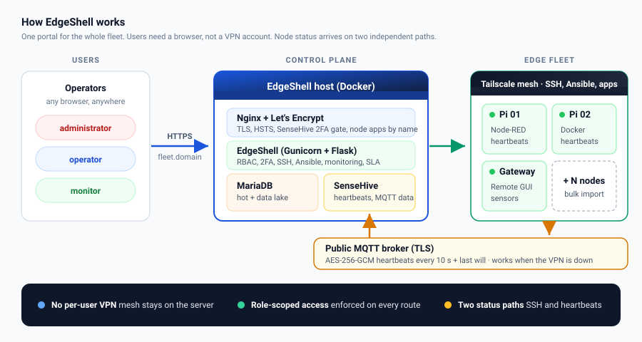
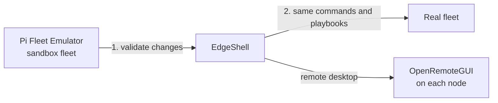
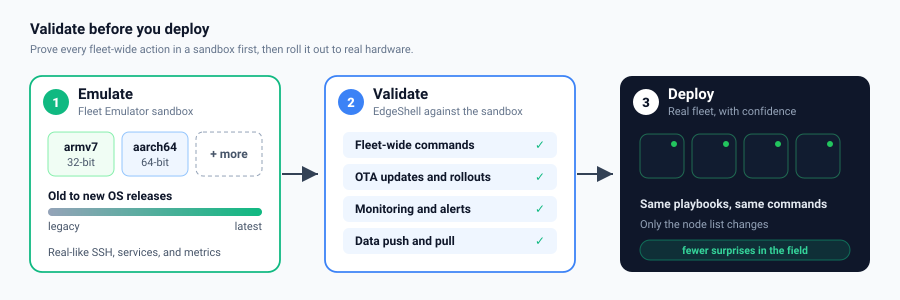
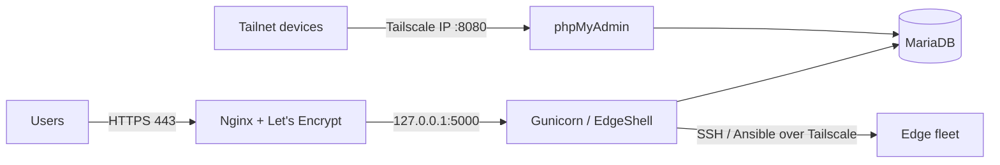
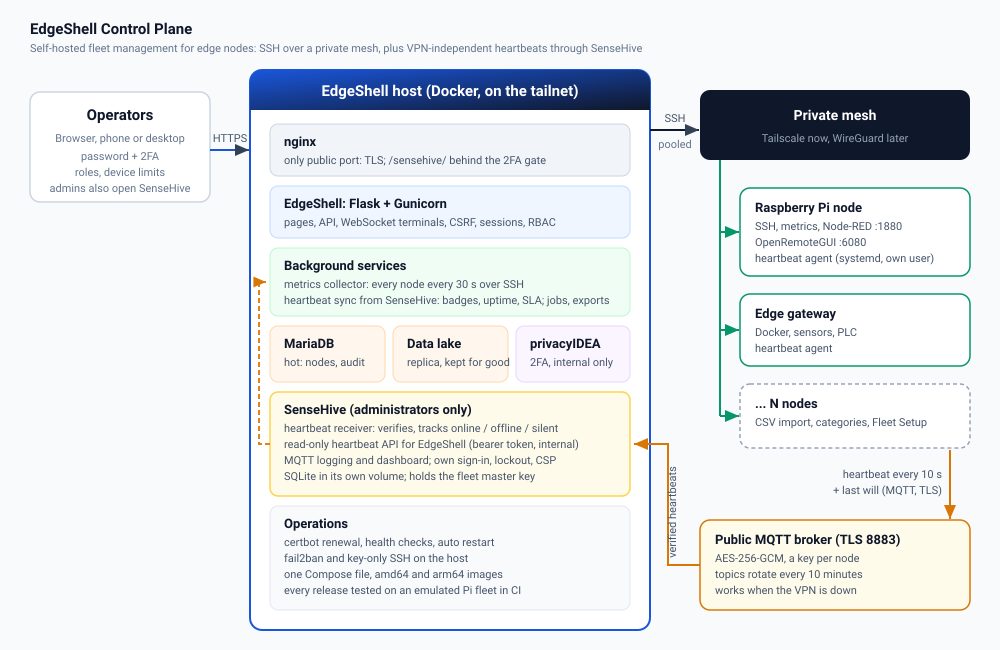
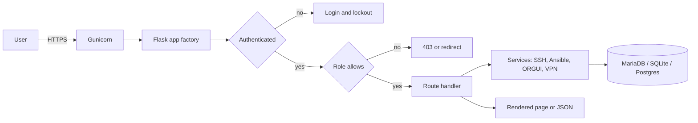
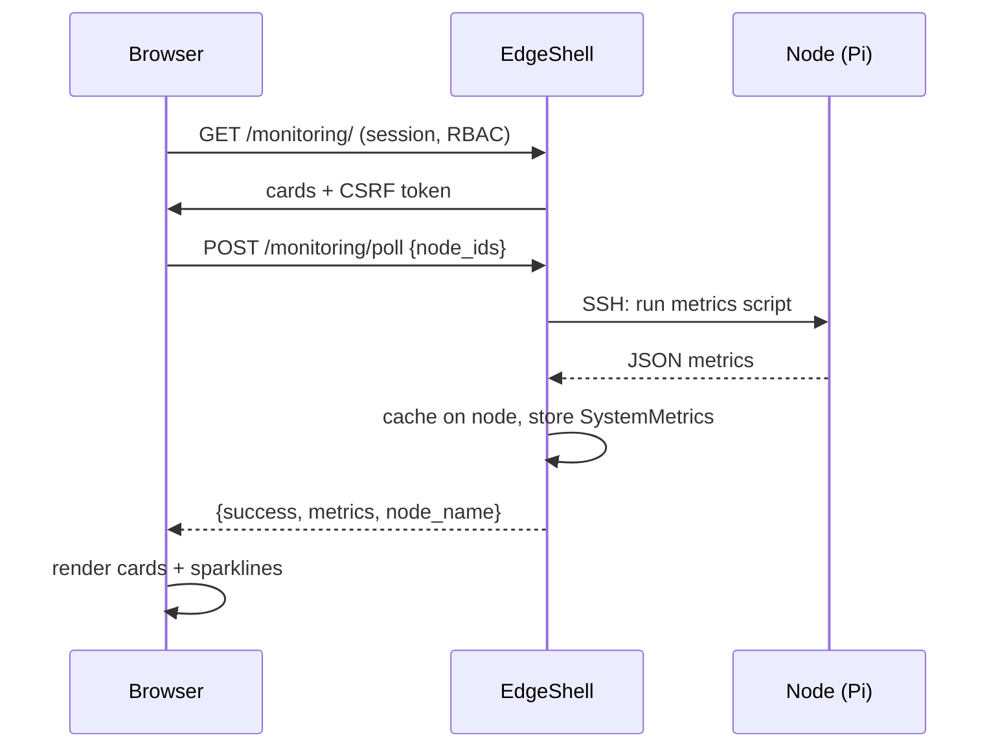
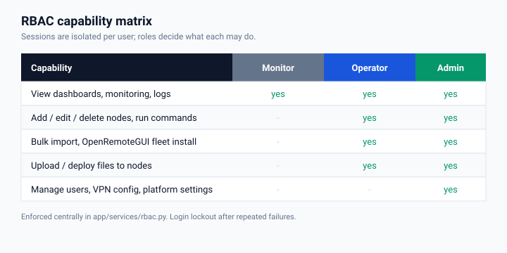
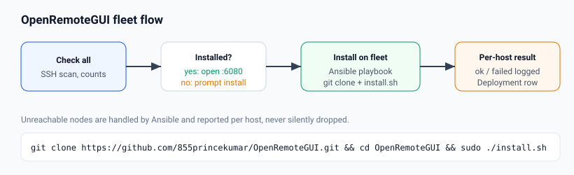

<div align="center">



**Self-hosted fleet management for Raspberry Pi and edge devices.**<br>
Monitor, control, and deploy to your whole edge fleet over SSH and Ansible, from one secure web portal.

<!-- Project -->
[](https://github.com/855princekumar/edgeshell/actions/workflows/ci.yml)
[](https://github.com/855princekumar/edgeshell/actions/workflows/release.yml)
[](CHANGELOG.md)
[](LICENSE)
[](CONTRIBUTING.md)

<!-- Container -->
[](https://hub.docker.com/r/devprincekumar/edgeshell)
[](https://hub.docker.com/r/devprincekumar/edgeshell)
[](https://hub.docker.com/r/devprincekumar/edgeshell)
[](#run-on-any-cloud-amd64-and-arm64)

<!-- Stack -->
[](requirements.txt)
[](https://flask.palletsprojects.com/)
[](ansible/)
[](docs/DEPLOY-EC2.md)
[](docs/VPN-NETWORK.md)
[](https://github.com/855princekumar/pi-fleet-emulator)

[Features](#features) ·
[Quick start](#quick-start) ·
[Sandbox](#validate-before-you-deploy-sandbox-with-pi-fleet-emulator) ·
[Any cloud](#run-on-any-cloud-amd64-and-arm64) ·
[Production on EC2](#production-deployment-aws-ec2) ·
[Architecture](#architecture) ·
[Docs](#documentation)

</div>

---

<details open>
<summary><b>Table of contents</b></summary>

- [Why EdgeShell](#why-edgeshell)
- [The ecosystem](#the-ecosystem)
- [Features](#features)
  - [Fleet operations](#fleet-operations) · [Security and access](#security-and-access) · [Platform](#platform)
- [Quick start](#quick-start)
  - [Docker](#1-docker-any-machine-amd64-or-arm64) · [Docker Compose](#2-docker-compose) · [Local](#3-local-windows-macos-linux) · [Sandbox](#4-sandbox-edgeshell--an-emulated-fleet)
- [Validate before you deploy: sandbox with Pi Fleet Emulator](#validate-before-you-deploy-sandbox-with-pi-fleet-emulator)
- [Run on any cloud (amd64 and arm64)](#run-on-any-cloud-amd64-and-arm64)
- [Production deployment (AWS EC2)](#production-deployment-aws-ec2)
  - [What you get](#what-you-get) · [Instance](#step-1-prepare-the-instance) · [Security group](#step-2-security-group-inbound-rules) · [Tailscale](#step-3-join-the-instance-to-tailscale) · [Install](#step-4-install-edgeshell) · [Operate](#step-5-operate)
- [Architecture](#architecture)
  - [Request lifecycle](#request-lifecycle) · [Monitoring](#how-monitoring-works) · [Roles](#roles) · [Remote desktop](#remote-desktop-across-the-fleet)
- [Configuration](#configuration)
- [Management CLI](#management-cli)
- [CI/CD and quality gates](#cicd-and-quality-gates)
- [Project layout](#project-layout)
- [Development](#development)
- [Documentation](#documentation)
- [Roadmap](#roadmap)
- [Security](#security)
  - [Login protection](#login-protection) · [Session protection](#session-protection) · [Platform](#platform-1)
- [Contributing](#contributing)
- [License](#license)

</details>

## Why EdgeShell

Managing a handful of Raspberry Pis is easy. Managing dozens across factories,
warehouses, and outdoor sites is not: every device needs SSH access, monitoring,
software installs, and log collection, and handing every operator a VPN account
does not scale.

EdgeShell puts **one control plane** on a single host (for example an EC2
instance) that is already joined to your private mesh (Tailscale or WireGuard).
People sign in to a normal HTTPS website, get access scoped to their role, and
operate the fleet from the browser. **The mesh stays on the server, not on every
user's laptop.**



**Built for:** IoT and industrial edge teams, labs and universities, makers
running Pi clusters, and anyone who wants a self-hosted alternative to SaaS
device-management tools.

## The ecosystem

EdgeShell is one of three open-source projects that work together. Each has its
own repository and releases.

| Project | Role | Images |
|---|---|---|
| **EdgeShell** (this repo) | The control plane: monitoring, commands, deployments, users and roles | [`devprincekumar/edgeshell`](https://hub.docker.com/r/devprincekumar/edgeshell) |
| **[Pi Fleet Emulator](https://github.com/855princekumar/pi-fleet-emulator)** | Spawns a realistic Raspberry Pi fleet in Docker (real SSH and Node-RED, 32/64-bit, Buster to Bookworm). EdgeShell's CI tests every change against it | [`pi-fleet-spawner`](https://hub.docker.com/r/devprincekumar/pi-fleet-spawner), [`pi-fleet-node`](https://hub.docker.com/r/devprincekumar/pi-fleet-node) |
| **[OpenRemoteGUI](https://github.com/855princekumar/OpenRemoteGUI)** | Browser-based remote desktop for Debian and Raspberry Pi. Powers the **Remote** button on every node | installed on nodes by EdgeShell |



## Features

### Fleet operations
| Capability | What it does |
|---|---|
| **Live monitoring** | CPU, memory, disk, load, temperature, network, Docker and Node-RED status per node, with history and sparklines |
| **Web terminal** | Run commands on any node from the browser, with a persistent working directory per session |
| **Remote desktop** | One-click [OpenRemoteGUI](https://github.com/855princekumar/OpenRemoteGUI) per node: auto-detect, install if missing, or install fleet-wide |
| **Node-RED access** | Open each node's own Node-RED editor at its real address and port |
| **File deployment** | Upload files to many nodes at once, with per-node results and history |
| **Log browser** | Browse, fetch, and download log files from any node |
| **Fleet setup** | Scan the fleet for Docker, Node-RED, and OpenRemoteGUI; install on every node missing them |
| **Bulk onboarding** | Import CSV, TXT or JSON (including a Pi Fleet Emulator export) with automatic column detection and a verify step before anything is created |
| **Architecture detection** | 32-bit (ARMv7) and 64-bit (ARM64) detected automatically, shown as badges and filters |

### Security and access
| Capability | What it does |
|---|---|
| **Role-based access** | `monitor` (read-only), `operator` (fleet control), `administrator` (users and platform), enforced on every route |
| **Hardened login** | Account lockout, per-IP rate limiting, forced password change, and login errors that never reveal which usernames exist |
| **Session control** | One device at a time by default; admins can allow up to 4 per user. Password resets and "sign out everywhere" end sessions instantly |
| **Two-factor auth** *(coming soon)* | Mandatory 2FA for every account, in a separate build currently in security testing |
| **Encrypted credentials** | Node SSH passwords and API keys encrypted at rest (Fernet), with key rotation |
| **CSRF everywhere** | Every state-changing request and AJAX call is protected |
| **Fail-safe config** | Production refuses to start without its secret keys |
| **Audit trail** | Activity log of user actions plus every service start, stop, crash, and restart |

### Platform
| Capability | What it does |
|---|---|
| **Multi-arch image** | `devprincekumar/edgeshell` for amd64 and arm64: x86 clouds, AWS Graviton, Ampere Altra, Raspberry Pi 4/5 |
| **One-command install** | `python3 run.py` sets up MariaDB, Nginx, Let's Encrypt TLS, phpMyAdmin, and systemd on Ubuntu/Debian. Re-run it to update |
| **Self-healing** | systemd auto-start on boot, crash restart, and a health-check watchdog |
| **Sandbox** | EdgeShell plus a 6-node emulated fleet and a full end-to-end suite in one command |
| **VPN heartbeat** | Mesh status badge for Tailscale today, WireGuard via one setting |
| **Issue portal** | Built-in support tickets with threaded replies and optional email via [useSend](https://usesend.com) |
| **Database portability** | SQLite (WAL) for development, MariaDB in production, PostgreSQL supported; one-command export and import |

## Quick start

| I want to... | Use | Time |
|---|---|---|
| Run it anywhere in one command | [Docker](#1-docker-any-machine-amd64-or-arm64) | 1 min |
| Keep it running with settings in a file | [Docker Compose](#2-docker-compose) | 3 min |
| Develop on my PC | [Local](#3-local-windows-macos-linux) | 2 min |
| Try it against a realistic fleet, no hardware | [Sandbox](#4-sandbox-edgeshell--an-emulated-fleet) | 5 min |
| Run it for real behind TLS | [Production on EC2](#production-deployment-aws-ec2) | 20 min |

### 1. Docker (any machine, amd64 or arm64)

```bash
docker run -d --name edgeshell -p 5000:5000 \
  -e SECRET_KEY="$(openssl rand -hex 32)" \
  -e CREDENTIAL_KEY="$(openssl rand -hex 32)" \
  -e SESSION_COOKIE_SECURE=false \
  -v edgeshell_instance:/app/instance -v edgeshell_uploads:/app/uploads \
  --add-host host.docker.internal:host-gateway \
  devprincekumar/edgeshell:latest
```

Open **http://localhost:5000** and sign in as `admin` / `admin123` (you must
change it on first login). Docker pulls the right architecture automatically.

> [!IMPORTANT]
> Save the `CREDENTIAL_KEY` you used. It encrypts the stored node SSH
> passwords, so restarting with a different key means re-entering them. The
> Compose setup below keeps both keys in `.env` for you.

### 2. Docker Compose

```bash
git clone https://github.com/855princekumar/edgeshell.git && cd edgeshell
cp .env.example .env
python -c "import secrets; print('SECRET_KEY=' + secrets.token_hex(32))"
python -c "import secrets; print('CREDENTIAL_KEY=' + secrets.token_hex(32))"
# paste both lines into .env, then:
docker compose up -d            # pulls devprincekumar/edgeshell
docker compose up -d --build    # or build from this checkout
```

Data persists in the `edgeshell_instance` and `edgeshell_uploads` volumes. To
reach nodes over a mesh from inside a container, see
[docs/VPN-NETWORK.md](docs/VPN-NETWORK.md).

### 3. Local (Windows, macOS, Linux)

Requires **Python 3.11 to 3.13** and Git.

```bash
git clone https://github.com/855princekumar/edgeshell.git
cd edgeshell
python run.py --dev
```

`run.py` creates a virtual environment, installs dependencies, generates a
`.env` with random secret keys, creates the database, and starts the server.
(On Windows and macOS `--dev` is the default and can be left off. On Linux,
`python3 run.py` without `--dev` runs the production installer instead.)

### 4. Sandbox: EdgeShell + an emulated fleet

Needs Docker with Compose v2, curl and Python 3.

```bash
git clone https://github.com/855princekumar/edgeshell.git && cd edgeshell
bash sandbox/run.sh --keep
```

This builds EdgeShell, starts [Pi Fleet Emulator](https://github.com/855princekumar/pi-fleet-emulator),
spawns 6 Pi nodes, imports them, runs the full end-to-end suite and leaves
everything running for you to explore:

| Service | URL |
|---|---|
| EdgeShell | http://127.0.0.1:5050 |
| Pi Fleet Emulator spawner | http://127.0.0.1:7070 |

The suite gives the sandbox `admin` account a random password each run. To
sign in yourself, reset it with
`docker exec edgeshell-sandbox python manage.py create-admin --username me --email me@example.test --password <yours>`.
Drop `--keep` to tear everything down automatically.

## Validate before you deploy: sandbox with Pi Fleet Emulator



A command that works on one Pi can still break a hundred. Field fleets are
mixed: different boards, 32-bit and 64-bit images, and OS releases from years
apart. **[Pi Fleet Emulator](https://github.com/855princekumar/pi-fleet-emulator)**,
a companion project built alongside EdgeShell, recreates such a fleet in Docker:
every node runs real OpenSSH and Node-RED, reports an ARM architecture and
Raspberry Pi OS, and answers `docker` and `systemctl` like a real Pi. To
EdgeShell it looks like hardware.

The [`sandbox/`](sandbox/) directory wires the two together and proves every
fleet operation end to end. It runs on every push in CI, on both amd64 and
native arm64 runners.

**The sandbox fleet:**

| Node | Architecture | OS |
|---|---|---|
| `bookworm64` / `bookworm32` | aarch64 / armv7l | Raspberry Pi OS 12 (Bookworm) |
| `bullseye64` / `bullseye32` | aarch64 / armv7l | Raspberry Pi OS 11 (Bullseye) |
| `buster64` / `buster32` | aarch64 / armv7l | Raspberry Pi OS 10 (Buster) |

Change [`sandbox/fleet.json`](sandbox/fleet.json) to test any mix, up to 20 nodes.

**What [`sandbox/run.sh`](sandbox/run.sh) verifies:**

| Area | Checks |
|---|---|
| **Onboarding** | Emulator export imported as JSON; every node reachable over SSH |
| **Fleet control** | Connection test and architecture detection per node; one command across the fleet returns each node's own OS and architecture |
| **Monitoring** | Metrics from every node; Node-RED detected on every node |
| **Data push and pull** | A file deployed to every node, then fetched back from each |
| **OTA-style rollout** | An update package pushed, applied with `sudo` and its version verified on every node |
| **Ansible** | `ansible-core` inside the image runs a play on every host with per-host results |
| **Security** | Session limits and takeover prompt, stolen cookie rejected after logout, password reset ends sessions, brute-force lockout, identical login errors, monitor role blocked from commands and deploys |
| **Image hardening** | Non-root user, read-only code, no `.env`, databases or keys inside the image |
| **Resilience** | Admin password and all nodes survive a container restart |

```bash
bash sandbox/run.sh                                                 # build from source, test, tear down
EDGESHELL_IMAGE=devprincekumar/edgeshell:1.2.0 bash sandbox/run.sh  # test a published image
```

**Your own workflow:** run a change (command, playbook, file rollout) against
the sandbox fleet, check the results on the dashboard, then repeat it on the
real fleet with the same commands. Only the node list changes.

> [!NOTE]
> Emulated nodes *report* ARM but run on your host's CPU. Use the sandbox to
> validate management, deployment and monitoring flows, not ARM-compiled
> binaries. The older [`sim/`](sim/README-SIMULATION.md) demo is kept for
> reference; the sandbox replaces it.

## Run on any cloud (amd64 and arm64)

The image is published as a multi-arch manifest, so the same tag runs natively
everywhere:

| Platform | Examples |
|---|---|
| `linux/amd64` | AWS EC2 (Intel/AMD), Azure, GCP, DigitalOcean, Hetzner, any x86 server or laptop |
| `linux/arm64` | AWS Graviton, Oracle Cloud Ampere A1, Azure Ampere/Cobalt, Hetzner CAX, GCP Tau T2A, Raspberry Pi 4/5 (64-bit OS), Apple Silicon |

```bash
docker buildx imagetools inspect devprincekumar/edgeshell:latest   # lists both platforms
docker run --rm --entrypoint python devprincekumar/edgeshell:latest -c "import platform; print(platform.machine())"
```

Both architectures are built from the same Dockerfile, and both pass the full
sandbox suite on native runners before a release is published. To build
locally for both:

```bash
docker buildx build --platform linux/amd64,linux/arm64 -t edgeshell:local .
```

The image is also published as `ghcr.io/855princekumar/edgeshell`.

## Production deployment (AWS EC2)

A single command installs and configures the full stack. It is idempotent: run
it again any time to apply an update.

### What you get



| Component | Setup |
|---|---|
| **App** | Gunicorn bound to `127.0.0.1` only, runs as a dedicated `edgeshell` system user, code in `/opt/edgeshell` |
| **Web** | Nginx serves only your domain, with TLS and HSTS; requests to the raw IP are dropped |
| **TLS** | Let's Encrypt certificate, renewed automatically by `certbot.timer` |
| **Database** | MariaDB with least-privilege users; an existing SQLite database is migrated automatically |
| **DB admin** | phpMyAdmin reachable only on the Tailscale IP, behind basic auth and DB login, root disabled |
| **Services** | systemd units for the app, watchdog, and heartbeat, all enabled at boot |
| **Logs** | Everything goes to journald; service events are also recorded in the database |

### Step 1: Prepare the instance

| Item | Requirement |
|---|---|
| OS | Ubuntu 24.04 / 22.04 LTS or Debian 12 |
| Size | `t3.small` or larger (2 GB RAM) |
| Network | An **Elastic IP** attached to the instance |
| DNS | An `A` record, e.g. `fleet.yourdomain.com`, pointing to the Elastic IP |

### Step 2: Security group (inbound rules)

| Port | Source | Purpose |
|---|---|---|
| `443/tcp` | `0.0.0.0/0` | EdgeShell over HTTPS |
| `80/tcp` | `0.0.0.0/0` | Let's Encrypt validation and redirect to HTTPS |
| `22/tcp` | Your IP only | Admin SSH (or close it and use Tailscale SSH) |
| `41641/udp` | `0.0.0.0/0` | *Optional.* Direct Tailscale connections instead of relays |

> [!CAUTION]
> Never open `5000` (app), `3306` (MariaDB), or `8080` (phpMyAdmin). They are
> bound to loopback or the tailnet by design. Leave outbound traffic open.

`run.py` cannot change the AWS security group, so set it as above. On the
instance itself it enables a matching host firewall (ufw): inbound is allowed
only for your SSH port, 80, 443, 41641/udp and the Tailscale interface. After
start-up it audits every listening port and warns about anything else.
Set `EDGESHELL_FIREWALL=off` in the environment to skip the firewall step.

### Step 3: Join the instance to Tailscale

EdgeShell reads Tailscale status but does not install or configure it, so do this first:

```bash
curl -fsSL https://tailscale.com/install.sh | sh
sudo tailscale up
```

### Step 4: Install EdgeShell

```bash
git clone https://github.com/855princekumar/edgeshell.git
cd edgeshell
cp .env.example .env
nano .env        # set EDGESHELL_DOMAIN and LETSENCRYPT_EMAIL
python3 run.py   # asks for sudo, then installs everything
```

Generated passwords are printed once and saved to
`/root/edgeshell-credentials.txt` (readable by root only). Open
`https://fleet.yourdomain.com`, sign in as `admin / admin123`, and set a new
password.

> [!IMPORTANT]
> Back up `SECRET_KEY` and `CREDENTIAL_KEY` from `.env`. Node SSH passwords are
> encrypted with `CREDENTIAL_KEY`; without it, a database backup cannot decrypt them.

### Step 5: Operate

| Task | Command |
|---|---|
| Service status | `systemctl status edgeshell edgeshell-watchdog` |
| Live logs | `journalctl -u edgeshell -f` |
| Logs since today | `journalctl -u edgeshell --since today` |
| Watchdog restarts | `journalctl -u edgeshell-watchdog` |
| Restart | `sudo systemctl restart edgeshell` |
| Update | `git pull && python3 run.py` |
| Back up database | `sudo mariadb-dump --single-transaction edgeshell \| gzip > edgeshell-$(date +%F).sql.gz` |
| Uninstall | `sudo bash /opt/edgeshell/deploy/uninstall.sh` (add `--purge-data` to drop the DB) |

**Self-healing:** the app restarts 5 seconds after a crash, the watchdog
restarts it after 3 failed health checks in a row, and everything comes back
after a reboot. Each event is classified (boot, crash, watchdog, deploy,
shutdown) and shown on the Activity Log page.

**Troubleshooting:**

| Symptom | Fix |
|---|---|
| Certificate failed | Check the DNS `A` record resolves and port 80 is open, then re-run `python3 run.py` |
| phpMyAdmin only on `127.0.0.1` | Tailscale was not connected during install. Run `sudo tailscale up`, then re-run `python3 run.py` |
| Login fails with "CSRF session token is missing" | You are on plain HTTP at a non-localhost address. Use HTTPS, or set `SESSION_COOKIE_SECURE=false` for HTTP testing |
| Health check warning at the end of install | `journalctl -u edgeshell -n 100 --no-pager` |

Full guide: [docs/DEPLOY-EC2.md](docs/DEPLOY-EC2.md).

## Architecture



EdgeShell is a Flask application built with the app-factory pattern. Routes
handle HTTP and permissions; all side effects (SSH, Ansible, VPN, email) live in
`app/services`, so they are isolated and testable.

### Request lifecycle



### How monitoring works



### Roles



| Role | Can do |
|---|---|
| `monitor` | View dashboards, monitoring, and logs. Strictly read-only |
| `operator` | Everything a monitor can, plus node management, terminal, remote desktop, file deploy, bulk import |
| `administrator` | Everything an operator can, plus users, VPN, email, and platform settings |

Details: [docs/RBAC.md](docs/RBAC.md).

### Remote desktop across the fleet



Remote desktop is powered by
**[OpenRemoteGUI](https://github.com/855princekumar/OpenRemoteGUI)**, a
separate open-source project by the same author: a self-hosted, browser-based
remote desktop for Debian and Raspberry Pi. EdgeShell does not bundle it; it
detects, installs, and opens it on each node.

For each node EdgeShell checks whether OpenRemoteGUI is present (systemd unit,
listening port, or install directory). If it is, the **Remote** button opens it.
If not, you can install it over SSH with one click. Fleet-wide installs run
through Ansible, so every host reports success or failure individually. The
source repository is configurable with `ORGUI_REPO`.

## Configuration

All settings come from `.env` (or `-e` flags for Docker). The ones you are most likely to change:

| Variable | Default | Description |
|---|---|---|
| `EDGESHELL_DOMAIN` | *(empty)* | Public domain for production (enables Nginx + TLS) |
| `LETSENCRYPT_EMAIL` | *(empty)* | Email for Let's Encrypt expiry notices |
| `SECRET_KEY` | *(generated)* | Session signing key. **Required in production** |
| `CREDENTIAL_KEY` | *(generated)* | Encrypts node passwords and API keys. **Required in production** |
| `FLASK_ENV` | `development` | `development` or `production` |
| `DATABASE_URL` | SQLite in `instance/` | SQLAlchemy URL (set automatically by the production installer) |
| `DISPLAY_TZ` | `Asia/Kolkata` | Time zone for the UI and system clock. The database always stores UTC |
| `SESSION_HOURS` | `8` | Session lifetime |
| `SINGLE_SESSION` | `true` | Enforce each user's device limit (1 by default, up to 4, set by an admin) |
| `MAX_FAILED_LOGINS` / `LOCKOUT_MINUTES` | `5` / `15` | Account lockout policy |
| `SESSION_COOKIE_SECURE` | `false` (`true` in the image) | `true` behind HTTPS; `false` for plain-HTTP testing |
| `BEHIND_PROXY` | `false` | `true` behind a reverse proxy, so lockout, rate limits and audit see real client IPs |
| `GUNICORN_THREADS` | `8` | Worker threads in the container image |
| `VPN_BACKEND` | `tailscale` | `tailscale` or `wireguard` |
| `METRICS_RETENTION_DAYS` | `14` | How long monitoring history is kept |
| `EMAIL_ENABLED` | `false` | Turn on useSend email notifications for issues |

See [.env.example](.env.example) for the full list with comments.

## Management CLI

```bash
python manage.py seed                                   # create tables and default admin
python manage.py create-admin --username U --email E --password P
python manage.py db-export snapshot.json                # dump all data to JSON
python manage.py db-import snapshot.json --wipe         # load into the current DATABASE_URL
python manage.py migrate-sqlite instance/edgeshell.db   # copy a SQLite DB into the current DB
python manage.py reencrypt --old <OLD_CREDENTIAL_KEY>   # rotate the credential key
```

Snapshots keep node passwords encrypted. Moving between databases is covered in
[docs/MIGRATION.md](docs/MIGRATION.md).

## Project layout

```
edgeshell/
├── app/                  Flask app: factory, models, routes, services, templates
│   ├── models/           SQLAlchemy models (users, nodes, metrics, issues, events)
│   ├── routes/           Blueprints: nodes, monitoring, terminal, files, logs, users, ...
│   ├── services/         Side effects: SSH, Ansible, OpenRemoteGUI, VPN, RBAC, email
│   └── templates/        Jinja2 pages
├── ansible/              Playbooks for fleet-wide commands, deploys, log fetch, installs
├── deploy/               Production provisioner, systemd units, Nginx templates, scripts
├── docker/               Docker Hub description
├── docs/                 Guides, ADRs, and diagrams
├── sandbox/              EdgeShell + Pi Fleet Emulator stack and the end-to-end suite
├── sim/                  Older self-contained demo fleet (superseded by sandbox/)
├── tests/                pytest suite
├── .github/              CI, release and Dependabot workflows
├── Dockerfile            Multi-arch image (amd64 + arm64), non-root, allowlisted context
├── run.py                One entry point: dev server, production install, service runner
├── manage.py             Admin CLI
├── config.py             Environment-driven config (fails hard on missing prod secrets)
└── wsgi.py               WSGI entry point
```

## Development

```bash
python run.py --dev                                  # dev server with auto setup
FLASK_ENV=testing ./venv/bin/python -m pytest -q     # unit tests
bash sandbox/run.sh                                  # full end-to-end suite in Docker
```

Contribution guidelines and code conventions are in
[CONTRIBUTING.md](CONTRIBUTING.md).

## CI/CD and quality gates

Every push and pull request runs [CI](.github/workflows/ci.yml):

| Gate | What it checks |
|---|---|
| **Lint** | Python syntax and undefined names (ruff), shell scripts parse, both Compose files valid |
| **Secret scan** | gitleaks over the full Git history |
| **Unit tests** | pytest on Python 3.11, 3.12 and 3.13 |
| **Image** | amd64 and arm64 builds; non-root user, no `.env`, databases, keys or secrets in layers or history; refuses to start without keys; Trivy vulnerability scan to the Security tab |
| **Sandbox E2E** | The full [sandbox suite](#validate-before-you-deploy-sandbox-with-pi-fleet-emulator) on a native **amd64** runner and a native **arm64** runner |

[Releases](.github/workflows/release.yml) are cut by pushing a tag such as
`v1.2.0`. The release workflow reruns all of CI, and only if every gate passes
does it publish the multi-arch image to Docker Hub and GHCR (with SBOM and
build provenance), check that both architectures start, update the Docker Hub
description and create the GitHub release from the changelog.
Dependabot keeps Python packages, the base image and Actions up to date.

## Documentation

| Doc | Contents |
|---|---|
| [Getting started](docs/GETTING-STARTED.md) | Local, Docker, and production setup |
| [Deploy on EC2](docs/DEPLOY-EC2.md) | Full production guide, operations, and troubleshooting |
| [Architecture](docs/ARCHITECTURE.md) | Components, data model, monitoring contract |
| [Roles and access](docs/RBAC.md) | Roles, enforcement, lockout, sessions |
| [VPN and network](docs/VPN-NETWORK.md) | Tailscale, WireGuard, container networking |
| [Database migration](docs/MIGRATION.md) | SQLite to MariaDB or PostgreSQL |
| [Issue portal](docs/ISSUES.md) | Support tickets and useSend email |
| [Sandbox](sandbox/) | EdgeShell + Pi Fleet Emulator stack and end-to-end suite |
| [Pi Fleet Emulator](https://github.com/855princekumar/pi-fleet-emulator) | Companion project: emulated Raspberry Pi fleet in Docker |
| [Docker Hub page](https://hub.docker.com/r/devprincekumar/edgeshell) | Image tags, platforms and run options |
| [Decision records](docs/adr/) | Why the key design choices were made |
| [Changelog](CHANGELOG.md) | Release history |

## Roadmap

- [x] Tailscale mesh support with heartbeat
- [x] One-command production install on EC2 with TLS and systemd
- [x] Single-session enforcement and restart auditing
- [x] Per-user session limits (1 to 4 devices) with server-side revocation
- [x] Multi-arch image (amd64 + arm64) on Docker Hub and GHCR
- [x] Sandbox and CI end-to-end suite against Pi Fleet Emulator on amd64 and arm64
- [ ] **Mandatory two-factor authentication for all users** (separate build, in security testing)
- [ ] WireGuard as a first-class backend (status reading works today)
- [ ] Shared rate-limit store for multi-worker deployments
- [ ] UI screenshots and demo video

Ideas and feature requests are welcome in
[Issues](https://github.com/855princekumar/edgeshell/issues).

## Security

### Login protection

| Threat | Protection |
|---|---|
| **Password guessing on one account** | After 5 wrong passwords (`MAX_FAILED_LOGINS`) the account locks for 15 minutes (`LOCKOUT_MINUTES`). While locked, even the correct password is refused |
| **Guessing from one address** | The login form is rate limited to 20 attempts per minute per IP |
| **Discovering usernames** | Every failure shows the same message, and unknown usernames take the same time to answer as real ones |
| **Weak or default passwords** | Passwords are bcrypt-hashed, at least 8 characters, and the seeded `admin` must change its password on first login |

### Session protection

| Threat | Protection |
|---|---|
| **Account shared or used on too many devices** | Each account allows **1 device by default**, including admins. Only an administrator can raise it, **up to 4** (for example phone, tablet, laptop), when creating the user or later in User Management |
| **Signing in on one more device** | The user sees which device will be signed out (device, IP, last active) and must confirm. The oldest device is signed out within seconds |
| **Stolen session cookie** | Cookies are HttpOnly, SameSite, and Secure behind TLS. Every request is checked against a server-side session record, so logging out makes a copied cookie useless immediately |
| **Compromised account** | A password change signs out every other session. An admin password reset, disabling the account, or **Sign out everywhere** ends all of that user's sessions at once |
| **Forged requests** | CSRF tokens on every state-changing request, plus same-origin redirect checks |
| **Idle sessions** | Sessions expire after 8 hours without activity (`SESSION_HOURS`) |

> [!NOTE]
> **Mandatory two-factor authentication** for every user is being built as a
> separate release and is currently in security testing. When it ships,
> administrators will be able to require 2FA for all accounts they create. It
> will be announced in the [Changelog](CHANGELOG.md).

### Platform

- Production refuses to start without `SECRET_KEY` and `CREDENTIAL_KEY`.
- Node SSH passwords are encrypted at rest; rotate with `manage.py reencrypt`.
- The app, database, and phpMyAdmin are never exposed directly to the internet.

Please report vulnerabilities privately as described in [SECURITY.md](SECURITY.md),
not in public issues.

## Contributing

Contributions are welcome. Read [CONTRIBUTING.md](CONTRIBUTING.md), open an
issue to discuss larger changes, and mention anything that needs real-hardware
testing (SSH, fleet operations, WireGuard) in your pull request.

## License

[MIT](LICENSE) © 2026 Princekumar ([@855princekumar](https://github.com/855princekumar))

<div align="center">

If EdgeShell helps you manage your fleet, consider giving it a ⭐

</div>
