<div align="center">


**Self-hosted fleet management for Raspberry Pi and edge devices.**<br>
Monitor, control, and deploy to your whole edge fleet over SSH and Ansible, from one secure web portal.

<!-- Project -->
[](https://github.com/855princekumar/edgeshell/actions/workflows/ci.yml)
[](https://github.com/855princekumar/edgeshell/actions/workflows/release.yml)
[](CHANGELOG.md)
[](LICENSE)
[](CONTRIBUTING.md)

<!-- Container -->
[](https://hub.docker.com/r/devprincekumar/edgeshell)
[](https://hub.docker.com/r/devprincekumar/edgeshell)
[](https://hub.docker.com/r/devprincekumar/edgeshell)
[](#run-on-any-cloud-amd64-and-arm64)

<!-- Stack -->
[](requirements.txt)
[](https://flask.palletsprojects.com/)
[](ansible/)
[](docs/DEPLOY-EC2.md)
[](docs/VPN-NETWORK.md)
[](https://github.com/855princekumar/pi-fleet-emulator)

[Features](#features) ·
[Quick start](#quick-start) ·
[Sandbox](#validate-before-you-deploy-sandbox-with-pi-fleet-emulator) ·
[Any cloud](#run-on-any-cloud-amd64-and-arm64) ·
[Production on EC2](#production-deployment-aws-ec2) ·
[Architecture](#architecture) ·
[Docs](#documentation)

</div>

---

<details open>
<summary><b>Table of contents</b></summary>

- [Why EdgeShell](#why-edgeshell)
- [Screenshots](#screenshots)
- [The ecosystem](#the-ecosystem)
- [Features](#features)
  - [Fleet operations](#fleet-operations) · [Security and access](#security-and-access) · [Platform](#platform)
- [Quick start](#quick-start)
  - [Docker](#1-docker-any-machine-amd64-or-arm64) · [Docker Compose](#2-docker-compose) · [Local](#3-local-windows-macos-linux) · [Sandbox](#4-sandbox-edgeshell--an-emulated-fleet)
- [Validate before you deploy: sandbox with Pi Fleet Emulator](#validate-before-you-deploy-sandbox-with-pi-fleet-emulator)
- [Run on any cloud (amd64 and arm64)](#run-on-any-cloud-amd64-and-arm64)
- [Production deployment (AWS EC2)](#production-deployment-aws-ec2)
  - [What you get](#what-you-get) · [Instance](#step-1-prepare-the-instance) · [Security group](#step-2-security-group-inbound-rules) · [Tailscale](#step-3-join-the-instance-to-tailscale) · [Install](#step-4-install-edgeshell) · [Operate](#step-5-operate)
- [Architecture](#architecture)
  - [Request lifecycle](#request-lifecycle) · [Monitoring](#how-monitoring-works) · [Roles](#roles) · [Remote desktop](#remote-desktop-across-the-fleet)
- [Configuration](#configuration)
- [Management CLI](#management-cli)
- [CI/CD and quality gates](#cicd-and-quality-gates)
- [Project layout](#project-layout)
- [Development](#development)
- [Documentation](#documentation)
- [Roadmap](#roadmap)
- [Security](#security)
  - [Login protection](#login-protection) · [Session protection](#session-protection) · [Platform](#platform-1)
- [Contributing](#contributing)
- [License](#license)

</details>

## Why EdgeShell

Managing a handful of Raspberry Pis is easy. Managing dozens across factories,
warehouses, and outdoor sites is not: every device needs SSH access, monitoring,
software installs, and log collection, and handing every operator a VPN account
does not scale.

EdgeShell puts **one control plane** on a single host (for example an EC2
instance) that is already joined to your private mesh (Tailscale or WireGuard).
People sign in to a normal HTTPS website, get access scoped to their role, and
operate the fleet from the browser. **The mesh stays on the server, not on every
user's laptop.**


**Built for:** IoT and industrial edge teams, labs and universities, makers
running Pi clusters, and anyone who wants a self-hosted alternative to SaaS
device-management tools.

## Screenshots

<table>
<tr>
<td width="50%">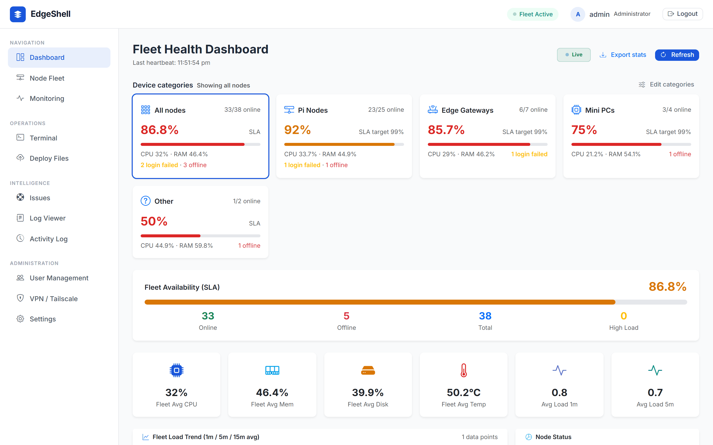<br><sub><b>Fleet dashboard</b>: device categories with their own SLA target, fleet availability and averages</sub></td>
<td width="50%">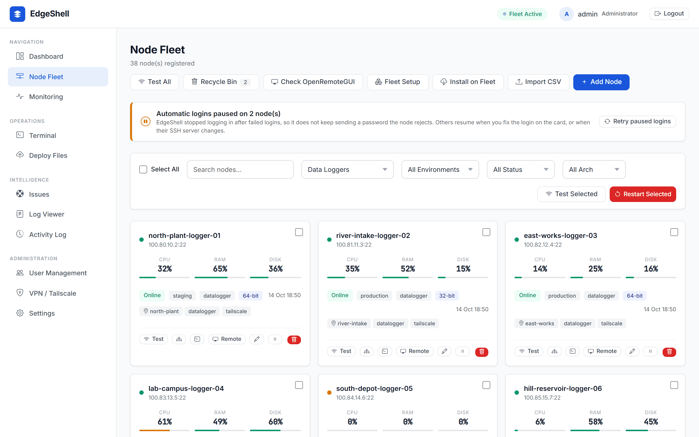<br><sub><b>Node Fleet</b>: live cards, filters by category, status and architecture; paused logins explained</sub></td>
</tr>
<tr>
<td width="50%">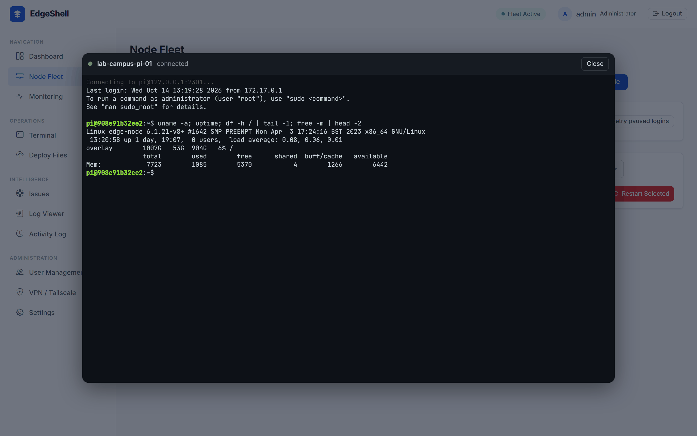<br><sub><b>Node terminal</b>: a real SSH shell on one node in the browser; closing the window ends the session</sub></td>
<td width="50%">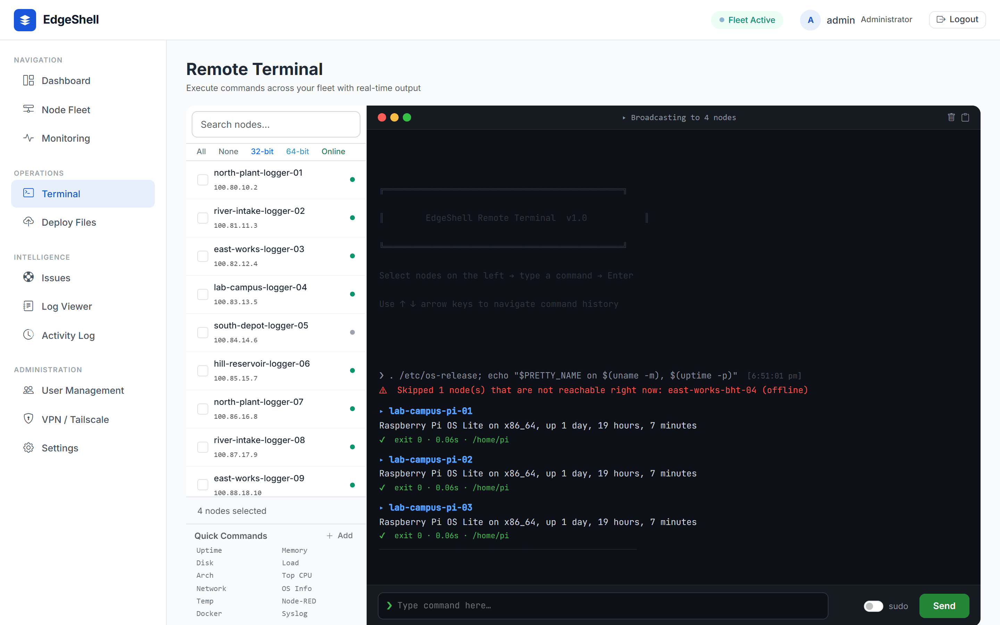<br><sub><b>Fleet terminal</b>: one command to many nodes, results stream in; unreachable nodes are skipped</sub></td>
</tr>
<tr>
<td width="50%">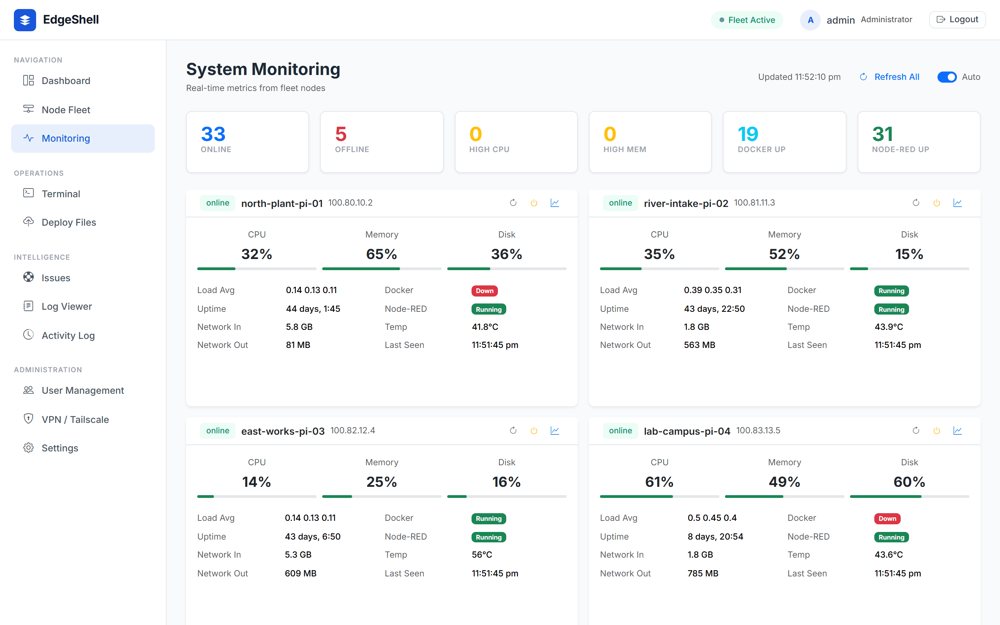<br><sub><b>Monitoring</b>: per-node metrics from the background collector; the Auto setting is remembered</sub></td>
<td width="50%">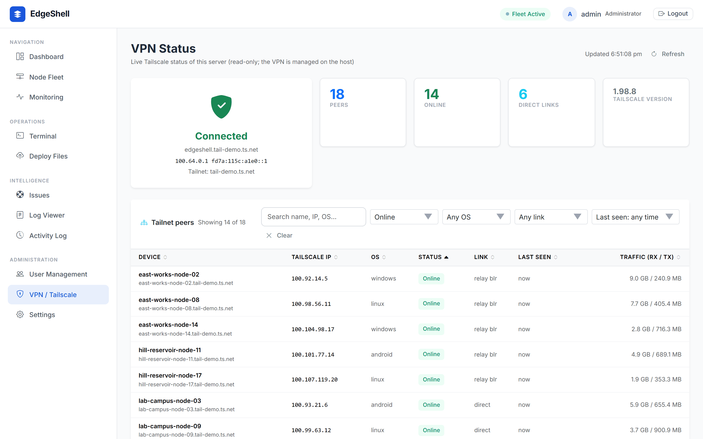<br><sub><b>VPN status</b>: live Tailscale peers with status, OS, link and last-seen filters and sorting</sub></td>
</tr>
<tr>
<td width="50%">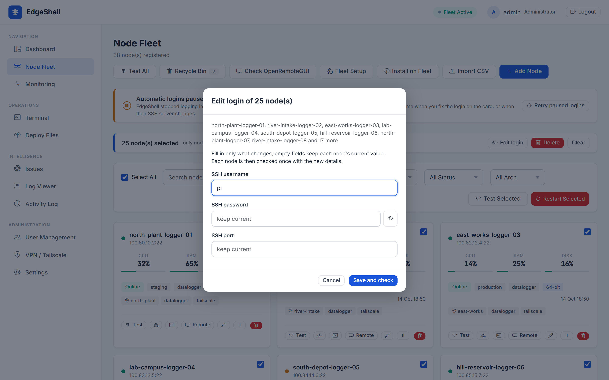<br><sub><b>Bulk login update</b>: new username, password or port for every selected node, checked once each</sub></td>
<td width="50%">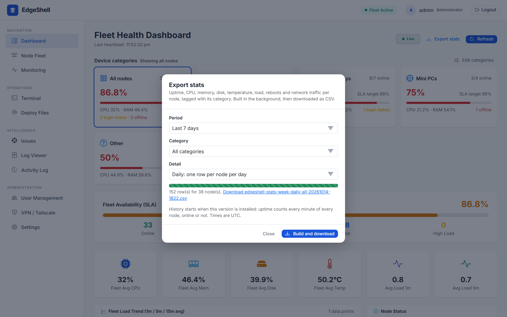<br><sub><b>Stats export</b>: uptime and resource history as CSV, built in the background with a progress bar</sub></td>
</tr>
<tr>
<td width="50%">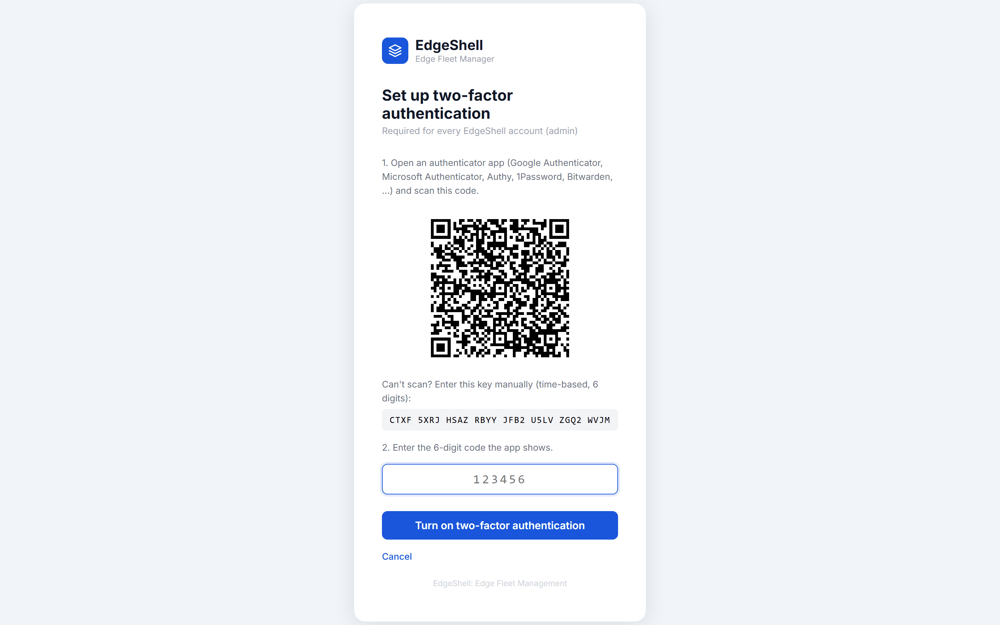<br><sub><b>Two-factor setup</b>: mandatory for every account: scan the QR code or type the key</sub></td>
<td width="50%">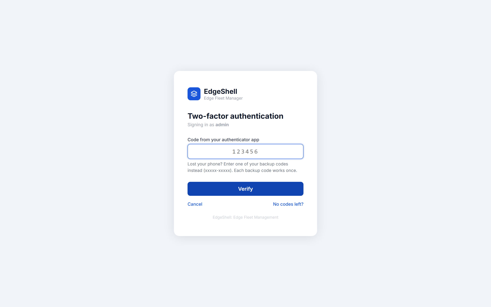<br><sub><b>Two-factor sign-in</b>: a 6-digit code (or a one-time backup code) after the password</sub></td>
</tr>
<tr>
<td width="50%">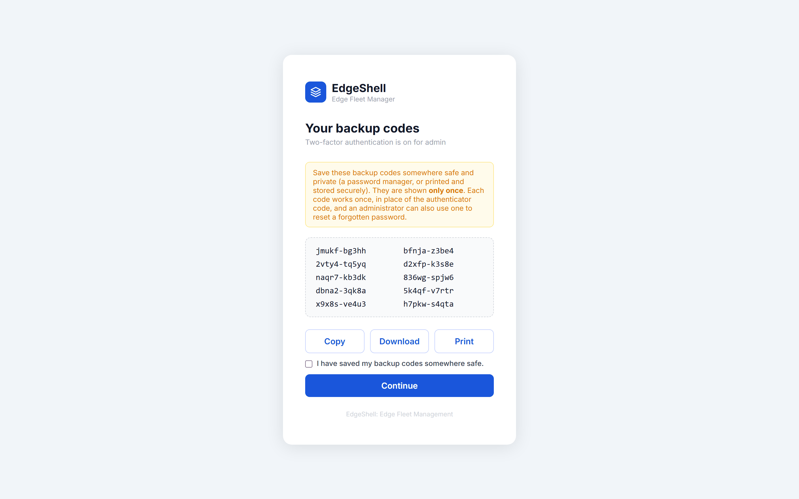<br><sub><b>Backup codes</b>: ten one-time codes, shown once, with copy, download and print</sub></td>
<td width="50%">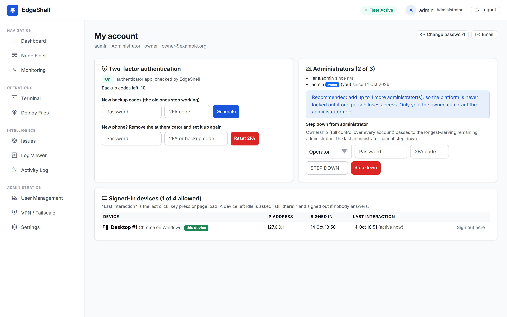<br><sub><b>My account</b>: 2FA status, new backup codes, administrators, signed-in devices</sub></td>
</tr>
<tr>
<td width="50%">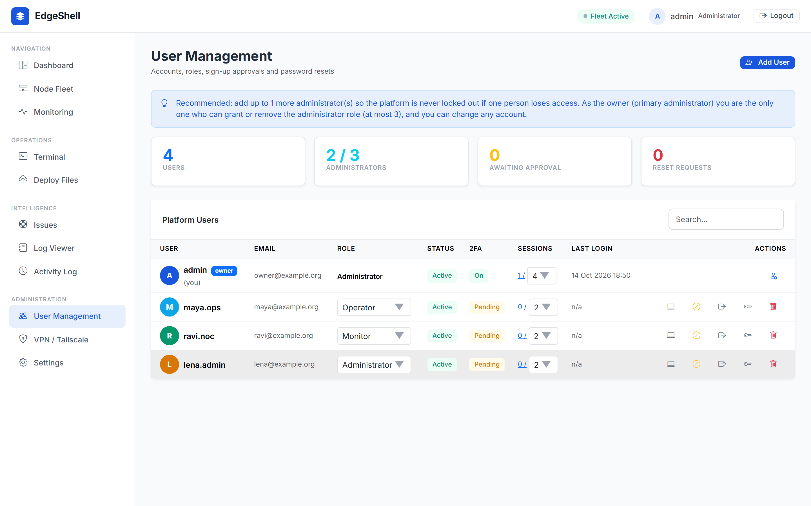<br><sub><b>User management</b>: roles, device limits, sign-up approvals and reset requests</sub></td>
<td width="50%">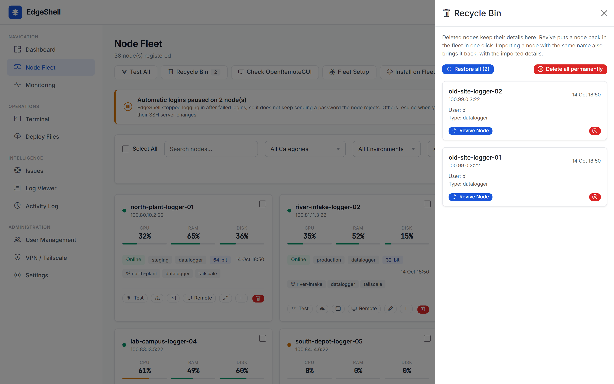<br><sub><b>Recycle Bin</b>: deleted nodes keep their details; restore all, or delete for good with a typed DELETE</sub></td>
</tr>
</table>

<p align="center">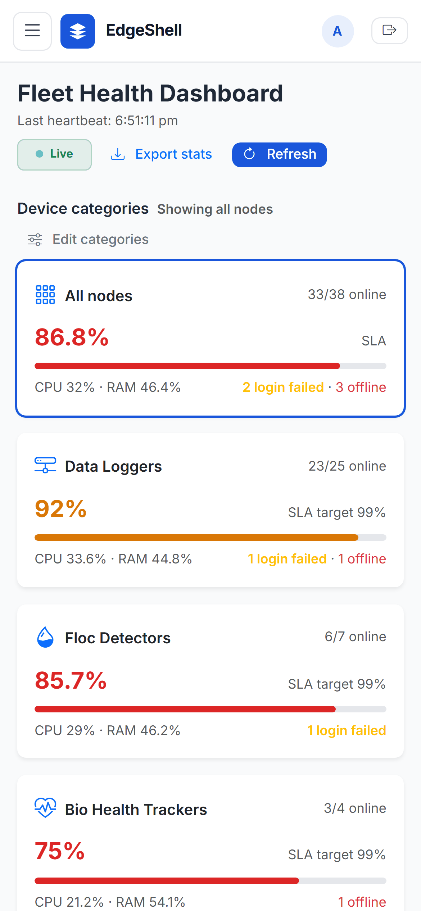&nbsp;&nbsp;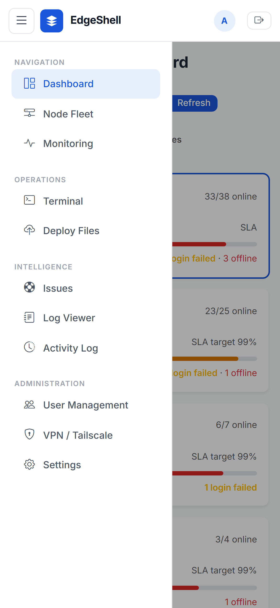<br><sub><b>On a phone</b>: every page adapts from phone to desktop and from 67 to 200 percent zoom (checked on every pull request)</sub></p>

<sub>Captured from a local demo instance with a simulated fleet (all names and
addresses are made up) and three <a href="https://github.com/855princekumar/pi-fleet-emulator">Pi Fleet Emulator</a>
nodes for the terminals. Regenerate them with
<a href="tools/screenshots.py"><code>tools/screenshots.py</code></a>.</sub>

## The ecosystem

EdgeShell is one of five open-source projects that work together as one system.
Each has its own repository and releases.

| Project | Role | Images |
|---|---|---|
| **EdgeShell** (this repo) | The control plane: monitoring, commands, deployments, users and roles | [`devprincekumar/edgeshell`](https://hub.docker.com/r/devprincekumar/edgeshell) |
| **[Pi Fleet Emulator](https://github.com/855princekumar/pi-fleet-emulator)** | Spawns a realistic Raspberry Pi fleet in Docker (real SSH and Node-RED, 32/64-bit, Buster to Bookworm). EdgeShell's CI tests every change against it | [`pi-fleet-spawner`](https://hub.docker.com/r/devprincekumar/pi-fleet-spawner), [`pi-fleet-node`](https://hub.docker.com/r/devprincekumar/pi-fleet-node) |
| **[OpenRemoteGUI](https://github.com/855princekumar/OpenRemoteGUI)** | Browser-based remote desktop for Debian and Raspberry Pi. Powers the **Remote** button on every node | installed on nodes by EdgeShell |
| **[SenseHive](https://github.com/855princekumar/sense-hive)** | MQTT logging and dashboard. In the EdgeShell stack it is the **heartbeat receiver**: it verifies encrypted heartbeats from every node and serves their state to EdgeShell (badges, uptime, SLA). Administrators open it at `/sensehive/` behind EdgeShell's sign-in and 2FA | [`devprincekumar/sense-hive`](https://hub.docker.com/r/devprincekumar/sense-hive), runs next to EdgeShell |
| **[MQTT heartbeat agent](https://github.com/855princekumar/mqtt-heartbeat-service)** | A small service on each node: an encrypted heartbeat every 10 s and an MQTT last will, over a public broker, so node status does not depend on the VPN | installed on nodes by EdgeShell (Fleet Setup) |

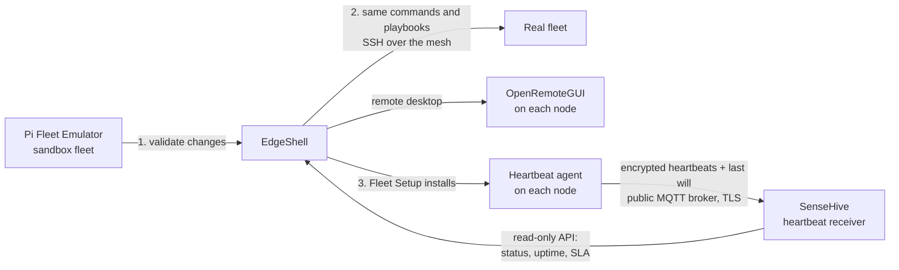

### Recommended setup

1. **Prove changes on the emulator.** Every EdgeShell release is tested in CI
   against a Pi Fleet Emulator fleet; do the same with your own playbooks.
2. **Run EdgeShell and SenseHive together** from the one Compose file
   (`docker/compose.yaml`): nginx, EdgeShell, MariaDB (hot and lake),
   privacyIDEA and SenseHive. Only nginx is public.
3. **Join the host to your mesh** (Tailscale) and import your nodes; EdgeShell
   manages them over SSH.
4. **Install the heartbeat agent** from **Fleet Setup** (a test group first,
   then the fleet). Each node gets its own key; the fleet master key stays on
   the server.
5. **Watch both paths:** SSH metrics every 30 s through the mesh, and
   heartbeats every 10 s through the broker. A node that is `online` by
   heartbeat but unreachable over SSH points at the VPN, not the node.

## Features

### Fleet operations
| Capability | What it does |
|---|---|
| **Fleet dashboard** | Availability (SLA) and fleet averages for CPU, memory, disk, temperature and load, plus a card per **device category** (for example Pi Nodes, Edge Gateways, Mini PCs) with its own SLA target. Click a category to scope the whole dashboard to it; administrators edit the categories |
| **Live monitoring** | A background collector checks every node every 30 seconds over one persistent SSH connection per node (one command reads `/proc`), so pages load instantly from its latest results. Per node: CPU, memory, disk, load, uptime, temperature, network, Docker and Node-RED, with history charts. The **Auto** refresh choice is saved on your account |
| **Node Fleet** | A card per node with live metrics, status, 32/64-bit badge, category, tags and last seen. Filter by category, environment, status (including "login failed") and architecture, or search |
| **Node terminal** | A terminal button on each card opens a real interactive SSH shell (xterm.js over a WebSocket, a real PTY on the node): colors, `top`, `nano`, tab completion, Ctrl+C, sudo. Closing the window ends the SSH session; it also closes after 30 minutes without input or when you sign out |
| **Fleet terminal** | One command to many nodes at once; each node's output streams in as it finishes. Offline and login-failed nodes are skipped with a notice. Working directory kept per session; sudo passwords go over stdin, never on a command line |
| **Bulk actions** | Select nodes (Select All respects the filters) to **edit their login** (username, password and/or port for all of them, each checked once) or **delete** them to the Recycle Bin |
| **Recycle Bin** | Deleted nodes keep their details. Restore one or all; importing a node with the same name brings it back with the new details and keeps its history; administrators can delete for good with a typed DELETE |
| **Fix login** | A node that rejects its login shows why on its card, with a one-click form to correct the username, password or port |
| **Bulk onboarding** | Import CSV, TXT or JSON (including a Pi Fleet Emulator export) with automatic column detection and a verify step; the SSH check of hundreds of new nodes runs in the background with a progress card |
| **Stats export** | Uptime, CPU, memory, disk, temperature, load, reboots and network traffic per node for the last 24 hours, week, month, quarter, semester or year; all categories or one; per hour, per day or per node. Built in the background with a progress bar, then downloaded as CSV for reports or a data lake |
| **Long-term history** | One sample per node per minute in every state (so uptime is measured, not guessed), rolled up hourly and kept for good |
| **VPN status** | Live Tailscale state of the server and every tailnet peer: status, OS, direct or relayed link, last seen, traffic. Filter by status, OS, link and last seen; sort any column |
| **Remote desktop** | One-click [OpenRemoteGUI](https://github.com/855princekumar/OpenRemoteGUI) per node at `https://<your domain>/remoteGUI/<node name>/`, through EdgeShell with no IP or port shown and no VPN needed (keyboard and mouse only with a ticket from the Remote button), with detection and a guided install: safety checks first (OS, disk, network, desktop session, sudo), then `git clone`, `cd`, `sudo bash install.sh`, with live progress; fleet installs stop at the first failure |
| **Node-RED access** | Each node's Node-RED editor at `https://<your domain>/nodered/<node name>/`, behind EdgeShell's sign-in and roles (operators and administrators), with the node's address hidden and no VPN needed; every opening logged ([ADR 0014](docs/adr/0014-nodered-through-edgeshell.md)) |
| **File deployment** | Upload files to many nodes at once, with per-node results and history. Files land only in `~/Downloads/edgeshell` on each node, never elsewhere |
| **Apps on the edge** | Ship any service or app the same way: a folder with a `manifest.json`, `esapp.py pack`, upload, roll out. Each app gets one folder in `/opt/edgeshell`, its own systemd service and user, its own Python venv (nothing system-wide), versions side by side with an atomic switch, and goes back to the previous version by itself when a new one does not stay up. Canary nodes first, automatic stop, one-click rollback, cleanup that always keeps the newest 3 stable versions, exact full removal, and every package kept on the server for the audit ([docs](docs/APPS.md)) |
| **Log browser** | Browse, fetch and download log files from any node |
| **Fleet setup** | Scan the fleet for Docker, Node-RED and OpenRemoteGUI; install on every node missing them |
| **Background jobs** | Long work (imports, installs, exports, login checks) runs in the background; a progress card follows you across pages, with a live step-by-step log |
| **Public API** | [REST API](docs/API.md) with an OpenAPI document: data points (latest metrics, time series, fleet summary), an event feed with a cursor for alerts and triggers in other systems, node management, exports and (optionally) commands. Sign in with password plus 2FA, or give an integration its own service key with chosen permissions, lifetime and allowed addresses |
| **Data lake** | A second MariaDB replicates the hot database live and keeps every row for good: metrics, rollups, events, activity and account history. Exports and history queries read from it. An optional hot retention policy (off by default) keeps only the last week, month, quarter, semester or year on the hot database, and never deletes what the lake has not got |
| **Architecture detection** | 32-bit (ARMv7) and 64-bit (ARM64) detected automatically, shown as badges and filters |
| **Field guide** | An animated, full-screen tour inside the app for site technicians and operators, opened from the **(i)** button in the top bar on every page: report a fault, start and close a job, confirm a swapped SD card or board, replace a dead node, what each sign on a node card means. One short headline per scene, a phone that taps through the real screens, and it fits any screen from a phone to a desktop ([docs](docs/HARDWARE.md#field-guide)) |
| **Hardware lifecycle** | Every check also reads each node's board serial, SD card or disk, network adapter and OS install, so a swapped SD card or board shows as **Hardware changed** ("SD card or disk replaced", "Board replaced") for an operator to confirm (with the reason) or reject as unexpected. A new node can be marked as the replacement of a broken one, which is retired with its history kept. **Anyone can report an issue** on a node (power supply, SD card, board...); operators resolve it. A fleet Hardware page shows faults per 100 nodes, time to fix, downtime and how long each kind of part lasts, with CSV, an API with a narrow `report` permission and signed webhooks ([docs](docs/HARDWARE.md)) |

### Security and access
| Capability | What it does |
|---|---|
| **Two-factor auth** | Mandatory for every account: authenticator app plus ten one-time backup codes, checked by [privacyIDEA](https://privacyidea.org) in its own isolated container (or the built-in verifier) |
| **Role-based access** | `monitor` (read-only), `operator` (fleet control), `administrator` (users and platform), enforced on every route |
| **Hardened login** | Account lockout, per-IP rate limiting, forced password change, and login errors that never reveal which usernames exist |
| **Account recovery** | Users request a reset from an admin (which also resets their 2FA); admins use an emailed link or a backup code |
| **Admin governance** | At most 5 admins; the owner (primary admin) is permanent and has full control over every account; other admins manage only monitors and operators; nobody can change the owner |
| **Sign-up approval** | Anyone can request an account; an admin approves it with a role |
| **Session control** | One device at a time by default, up to 4 per user (set by an admin). Each device is listed by type and can be signed out; idle sessions ask "still there?" and sign out |
| **Node login policy** | After repeated rejected logins (or one Tailscale SSH browser-check refusal) EdgeShell stops logging in to that node, so it never repeats a rejected password (no guessing, no fail2ban bans on the nodes). The pause survives restarts; nodes resume by themselves when their SSH server changes or the tailnet policy is fixed, or with **Retry paused logins** |
| **Safe SSH** | Every SSH connection goes through one helper that always closes failed connections and names Tailscale SSH refusals; a CI test fails the build if code opens SSH any other way |
| **Encrypted credentials** | Node SSH passwords and API keys encrypted at rest (Fernet), with key rotation |
| **CSRF everywhere** | Every state-changing request, AJAX call and WebSocket (same-origin check) is protected |
| **Fail-safe config** | Production refuses to start without its secret keys |
| **MQTT heartbeat** | A second, VPN-independent signal per node: an agent sends encrypted, authenticated heartbeats and a signed last will over a public MQTT broker; SenseHive verifies them; node cards show heartbeat and LWT state, and uptime counts a node as up when SSH or a heartbeat says so ([docs](docs/HEARTBEAT.md)) |
| **Audit trail** | Administrators only: activity log of user actions (logins, terminals opened and closed, bulk changes, exports, paused and resumed logins) plus every service start, stop, crash and restart |

### Platform
| Capability | What it does |
|---|---|
| **Docker stack** | One Compose file: EdgeShell, MariaDB, privacyIDEA, and nginx as the only public container, with free automatic HTTPS from Let's Encrypt (also for a bare IP address) |
| **Host hardening** | Script for fail2ban and a strict SSH policy on the server; [EC2 guide](docs/DEPLOY-EC2.md) for the whole setup |
| **Multi-arch image** | `devprincekumar/edgeshell` for amd64 and arm64: x86 clouds, AWS Graviton, Ampere Altra, Raspberry Pi 4/5 |
| **One-command install** | `python3 run.py` sets up MariaDB, Nginx, Let's Encrypt TLS, phpMyAdmin and systemd on Ubuntu/Debian. Re-run it to update |
| **Self-healing** | systemd auto-start on boot, crash restart and a health-check watchdog |
| **Works on any screen** | Phone menu, layouts from phone to desktop and from 67 to 200 percent zoom; a browser test checks every page at every size on every pull request |
| **Sandbox** | EdgeShell plus a 6-node emulated fleet and a full end-to-end suite in one command |
| **Issue portal** | Built-in support tickets with threaded replies and optional email via [useSend](https://usesend.com) |
| **Database portability** | SQLite (WAL) for development, MariaDB in production, PostgreSQL supported; one-command export and import |
| **Quality gates** | Required CI before every merge: lint, secret scan, Bandit, pip-audit and CodeQL, 330+ unit tests on three Python versions with a coverage floor, 550+ browser checks with 1500 nodes, a data lake test on real MariaDB, then image audit and end-to-end tests (including the API with real 2FA) on amd64 and arm64 |

## Quick start

| I want to... | Use | Time |
|---|---|---|
| Run it anywhere in one command | [Docker](#1-docker-any-machine-amd64-or-arm64) | 1 min |
| Run it in production with Docker (HTTPS + MariaDB) | [Production Compose](#production-compose-https--mariadb) | 5 min |
| Keep it running with settings in a file | [Docker Compose](#2-docker-compose) | 3 min |
| Develop on my PC | [Local](#3-local-windows-macos-linux) | 2 min |
| Try it against a realistic fleet, no hardware | [Sandbox](#4-sandbox-edgeshell--an-emulated-fleet) | 5 min |
| Run it for real behind TLS | [Production on EC2](#production-deployment-aws-ec2) | 20 min |

### 1. Docker (any machine, amd64 or arm64)

```bash
docker run -d --name edgeshell -p 5000:5000 \
  -e SECRET_KEY="$(openssl rand -hex 32)" \
  -e CREDENTIAL_KEY="$(openssl rand -hex 32)" \
  -e SESSION_COOKIE_SECURE=false \
  -v edgeshell_instance:/app/instance -v edgeshell_uploads:/app/uploads \
  --add-host host.docker.internal:host-gateway \
  devprincekumar/edgeshell:latest
```

Open **http://localhost:5000** and sign in as `admin` / `admin123`. The first
sign-in sets up two-factor authentication (scan the QR code with an
authenticator app and save the backup codes), a new password and your personal
email. Docker pulls the right architecture automatically.

> [!IMPORTANT]
> Save the `CREDENTIAL_KEY` you used. It encrypts the stored node SSH
> passwords, so restarting with a different key means re-entering them. The
> Compose setup below keeps both keys in `.env` for you.

### 2. Docker Compose

```bash
git clone https://github.com/855princekumar/edgeshell.git && cd edgeshell
cp .env.example .env
python -c "import secrets; print('SECRET_KEY=' + secrets.token_hex(32))"
python -c "import secrets; print('CREDENTIAL_KEY=' + secrets.token_hex(32))"
# paste both lines into .env, then:
docker compose up -d            # pulls devprincekumar/edgeshell
docker compose up -d --build    # or build from this checkout
```

Data persists in the `edgeshell_instance` and `edgeshell_uploads` volumes. To
reach nodes over a mesh from inside a container, see
[docs/VPN-NETWORK.md](docs/VPN-NETWORK.md).

### Production Compose (HTTPS + MariaDB)

[`docker/compose.yaml`](docker/compose.yaml) runs EdgeShell behind nginx, with
MariaDB, privacyIDEA (2FA) and certbot (Let's Encrypt once you set a domain).
All data lives in a `./data` folder on the host, and only nginx's ports 80 and
443 are exposed.

```bash
mkdir -p edgeshell/nginx && cd edgeshell
base=https://raw.githubusercontent.com/855princekumar/edgeshell/main/docker
curl -fsSLO $base/compose.yaml
curl -fsSLo nginx/entrypoint.sh $base/nginx/entrypoint.sh
curl -fsSLo nginx/certbot.sh $base/nginx/certbot.sh
curl -fsSLO $base/lake-init.sh
curl -fsSLo .env $base/.env.example && chmod 600 .env
for k in SECRET_KEY CREDENTIAL_KEY DB_PASSWORD DB_ROOT_PASSWORD MFA_ADMIN_PASSWORD MFA_PEPPER MFA_DB_PASSWORD MFA_SECRET_KEY; do
  sed -i "s|^$k=.*|$k=$(openssl rand -hex 32)|" .env; done
docker compose up -d       # http://<server IP>; add a domain later for HTTPS
```

Backups, upgrades and every setting are documented on the
[Docker Hub page](https://hub.docker.com/r/devprincekumar/edgeshell).

### 3. Local (Windows, macOS, Linux)

Requires **Python 3.11 to 3.13** and Git.

```bash
git clone https://github.com/855princekumar/edgeshell.git
cd edgeshell
python run.py --dev
```

`run.py` creates a virtual environment, installs dependencies, generates a
`.env` with random secret keys, creates the database, and starts the server.
(On Windows and macOS `--dev` is the default and can be left off. On Linux,
`python3 run.py` without `--dev` runs the production installer instead.)

### 4. Sandbox: EdgeShell + an emulated fleet

Needs Docker with Compose v2, curl and Python 3.

```bash
git clone https://github.com/855princekumar/edgeshell.git && cd edgeshell
bash sandbox/run.sh --keep
```

This builds EdgeShell, starts [Pi Fleet Emulator](https://github.com/855princekumar/pi-fleet-emulator),
spawns 6 Pi nodes, imports them, runs the full end-to-end suite and leaves
everything running for you to explore:

| Service | URL |
|---|---|
| EdgeShell | http://127.0.0.1:5050 |
| Pi Fleet Emulator spawner | http://127.0.0.1:7070 |

The suite gives the sandbox `admin` account a random password each run. To
sign in yourself, reset it with
`docker exec edgeshell-sandbox python manage.py create-admin --username me --email me@example.test --password <yours>`.
Drop `--keep` to tear everything down automatically.

## Validate before you deploy: sandbox with Pi Fleet Emulator


A command that works on one Pi can still break a hundred. Field fleets are
mixed: different boards, 32-bit and 64-bit images, and OS releases from years
apart. **[Pi Fleet Emulator](https://github.com/855princekumar/pi-fleet-emulator)**,
a companion project built alongside EdgeShell, recreates such a fleet in Docker:
every node runs real OpenSSH and Node-RED, reports an ARM architecture and
Raspberry Pi OS, and answers `docker` and `systemctl` like a real Pi. To
EdgeShell it looks like hardware.

The [`sandbox/`](sandbox/) directory wires the two together and proves every
fleet operation end to end. It runs on every push in CI, on both amd64 and
native arm64 runners.

**The sandbox fleet:**

| Node | Architecture | OS |
|---|---|---|
| `bookworm64` / `bookworm32` | aarch64 / armv7l | Raspberry Pi OS 12 (Bookworm) |
| `bullseye64` / `bullseye32` | aarch64 / armv7l | Raspberry Pi OS 11 (Bullseye) |
| `buster64` / `buster32` | aarch64 / armv7l | Raspberry Pi OS 10 (Buster) |

Change [`sandbox/fleet.json`](sandbox/fleet.json) to test any mix, up to 20 nodes.

**What [`sandbox/run.sh`](sandbox/run.sh) verifies:**

| Area | Checks |
|---|---|
| **Onboarding** | Emulator export imported as JSON; every node reachable over SSH |
| **Fleet control** | Connection test and architecture detection per node; one command across the fleet returns each node's own OS and architecture |
| **Monitoring** | Metrics from every node; Node-RED detected on every node |
| **Data push and pull** | A file deployed to every node, then fetched back from each |
| **OTA-style rollout** | An update package pushed, applied with `sudo` and its version verified on every node |
| **Ansible** | `ansible-core` inside the image runs a play on every host with per-host results |
| **Security** | Session limits and takeover prompt, stolen cookie rejected after logout, password reset ends sessions, brute-force lockout, identical login errors, monitor role blocked from commands and deploys |
| **Image hardening** | Non-root user, read-only code, no `.env`, databases or keys inside the image |
| **Resilience** | Admin password and all nodes survive a container restart |

```bash
bash sandbox/run.sh                                                 # build from source, test, tear down
EDGESHELL_IMAGE=devprincekumar/edgeshell:1.16.0 bash sandbox/run.sh  # test a published image
```

**Your own workflow:** run a change (command, playbook, file rollout) against
the sandbox fleet, check the results on the dashboard, then repeat it on the
real fleet with the same commands. Only the node list changes.

> [!NOTE]
> Emulated nodes *report* ARM but run on your host's CPU. Use the sandbox to
> validate management, deployment and monitoring flows, not ARM-compiled
> binaries. The older [`sim/`](sim/README-SIMULATION.md) demo is kept for
> reference; the sandbox replaces it.

## Run on any cloud (amd64 and arm64)

The image is published as a multi-arch manifest, so the same tag runs natively
everywhere:

| Platform | Examples |
|---|---|
| `linux/amd64` | AWS EC2 (Intel/AMD), Azure, GCP, DigitalOcean, Hetzner, any x86 server or laptop |
| `linux/arm64` | AWS Graviton, Oracle Cloud Ampere A1, Azure Ampere/Cobalt, Hetzner CAX, GCP Tau T2A, Raspberry Pi 4/5 (64-bit OS), Apple Silicon |

```bash
docker buildx imagetools inspect devprincekumar/edgeshell:latest   # lists both platforms
docker run --rm --entrypoint python devprincekumar/edgeshell:latest -c "import platform; print(platform.machine())"
```

Both architectures are built from the same Dockerfile, and both pass the full
sandbox suite on native runners before a release is published. To build
locally for both:

```bash
docker buildx build --platform linux/amd64,linux/arm64 -t edgeshell:local .
```

The image is also published as `ghcr.io/855princekumar/edgeshell`.

## Production deployment (AWS EC2)

A single command installs and configures the full stack. It is idempotent: run
it again any time to apply an update.

### What you get

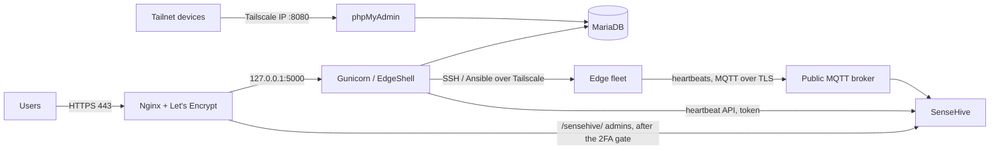

| Component | Setup |
|---|---|
| **App** | Gunicorn bound to `127.0.0.1` only, runs as a dedicated `edgeshell` system user, code in `/opt/edgeshell` |
| **Web** | Nginx serves only your domain, with TLS and HSTS; requests to the raw IP are dropped |
| **TLS** | Let's Encrypt certificate, renewed automatically by `certbot.timer` |
| **Database** | MariaDB with least-privilege users; an existing SQLite database is migrated automatically |
| **DB admin** | phpMyAdmin reachable only on the Tailscale IP, behind basic auth and DB login, root disabled |
| **Services** | systemd units for the app, watchdog, and heartbeat, all enabled at boot |
| **Logs** | Everything goes to journald; service events are also recorded in the database |

### Step 1: Prepare the instance

| Item | Requirement |
|---|---|
| OS | Ubuntu 26.04 / 24.04 / 22.04 LTS or Debian 12 |
| Size | `t3.small` or larger (2 GB RAM) |
| Network | An **Elastic IP** attached to the instance |
| DNS | An `A` record, e.g. `fleet.yourdomain.com`, pointing to the Elastic IP |

### Step 2: Security group (inbound rules)

| Port | Source | Purpose |
|---|---|---|
| `443/tcp` | `0.0.0.0/0` | EdgeShell over HTTPS |
| `80/tcp` | `0.0.0.0/0` | Let's Encrypt validation and redirect to HTTPS |
| `22/tcp` | Your IP only | Admin SSH (or close it and use Tailscale SSH) |
| `41641/udp` | `0.0.0.0/0` | *Optional.* Direct Tailscale connections instead of relays |

> [!CAUTION]
> Never open `5000` (app), `3306` (MariaDB), or `8080` (phpMyAdmin). They are
> bound to loopback or the tailnet by design. Leave outbound traffic open.

`run.py` cannot change the AWS security group, so set it as above. On the
instance itself it enables a matching host firewall (ufw): inbound is allowed
only for your SSH port, 80, 443, 41641/udp and the Tailscale interface. After
start-up it audits every listening port and warns about anything else.
Set `EDGESHELL_FIREWALL=off` in the environment to skip the firewall step.

### Step 3: Join the instance to Tailscale

EdgeShell reads Tailscale status but does not install or configure it, so do this first:

```bash
curl -fsSL https://tailscale.com/install.sh | sh
sudo tailscale up
```

If your nodes run **Tailscale SSH**, the tailnet policy (not the node password)
decides whether EdgeShell may log in, and the default rule waits for a browser
check that a server cannot give. Set up the accept rule described in
[Tailscale SSH on the nodes](docs/VPN-NETWORK.md#tailscale-ssh-on-the-nodes)
before importing the fleet, or every node will show "login failed" while ping
and Node-RED still work.

### Step 4: Install EdgeShell

```bash
git clone https://github.com/855princekumar/edgeshell.git
cd edgeshell
cp .env.example .env
nano .env        # set EDGESHELL_DOMAIN and LETSENCRYPT_EMAIL
python3 run.py   # asks for sudo, then installs everything
```

Generated passwords are printed once and saved to
`/root/edgeshell-credentials.txt` (readable by root only). Open
`https://fleet.yourdomain.com`, sign in as `admin / admin123`, then set up
two-factor authentication, a new password and your personal email.

> [!IMPORTANT]
> Back up `SECRET_KEY` and `CREDENTIAL_KEY` from `.env`. Node SSH passwords are
> encrypted with `CREDENTIAL_KEY`; without it, a database backup cannot decrypt them.

### Step 5: Operate

| Task | Command |
|---|---|
| Service status | `systemctl status edgeshell edgeshell-watchdog` |
| Live logs | `journalctl -u edgeshell -f` |
| Logs since today | `journalctl -u edgeshell --since today` |
| Watchdog restarts | `journalctl -u edgeshell-watchdog` |
| Restart | `sudo systemctl restart edgeshell` |
| Update | `git pull && python3 run.py` |
| Back up database | `sudo mariadb-dump --single-transaction edgeshell \| gzip > edgeshell-$(date +%F).sql.gz` |
| Uninstall | `sudo bash /opt/edgeshell/deploy/uninstall.sh` (add `--purge-data` to drop the DB) |

**Self-healing:** the app restarts 5 seconds after a crash, the watchdog
restarts it after 3 failed health checks in a row, and everything comes back
after a reboot. Each event is classified (boot, crash, watchdog, deploy,
shutdown) and shown on the Activity Log page.

**Troubleshooting:**

| Symptom | Fix |
|---|---|
| Certificate failed | Check the DNS `A` record resolves and port 80 is open, then re-run `python3 run.py` |
| phpMyAdmin only on `127.0.0.1` | Tailscale was not connected during install. Run `sudo tailscale up`, then re-run `python3 run.py` |
| Login fails with "CSRF session token is missing" | You are on plain HTTP at a non-localhost address. Use HTTPS, or set `SESSION_COOKIE_SECURE=false` for HTTP testing |
| Health check warning at the end of install | `journalctl -u edgeshell -n 100 --no-pager` |

Full guide: [docs/DEPLOY-EC2.md](docs/DEPLOY-EC2.md). How access is locked down (DNS, TLS, one open port, node addresses hidden, Node-RED and the remote desktop through EdgeShell): [docs/SECURE-ACCESS.md](docs/SECURE-ACCESS.md).

## Architecture


EdgeShell is a Flask application built with the app-factory pattern. In the
Docker stack, nginx is the only public container; the app, MariaDB and
privacyIDEA sit on internal networks. Routes handle HTTP and permissions; all
side effects (SSH, Ansible, VPN, email) live in `app/services`, so they are
isolated and testable. A background collector keeps one SSH connection per
node and checks every node every 30 seconds, so pages read its latest results
instead of logging in to nodes themselves. More in
[docs/ARCHITECTURE.md](docs/ARCHITECTURE.md).

### Request lifecycle

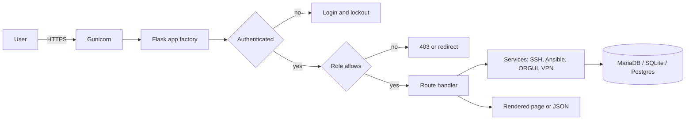

### How monitoring works

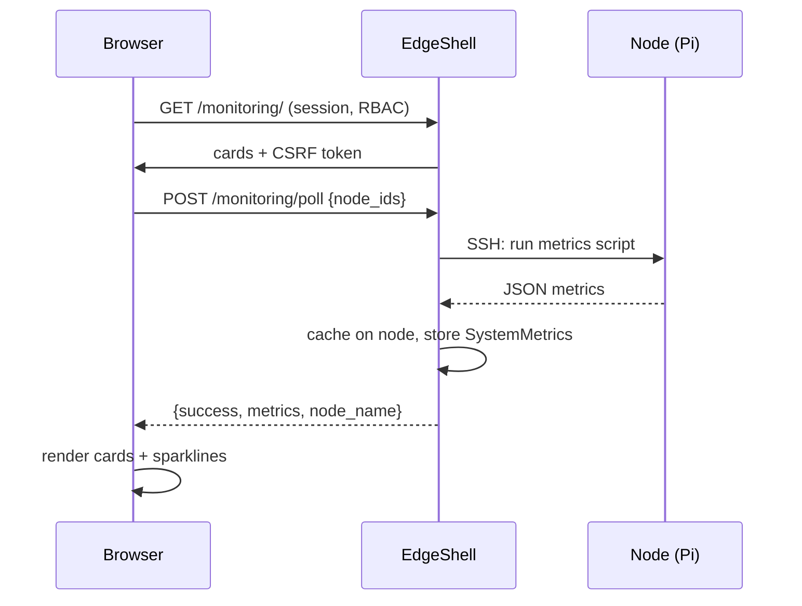

### Roles


| Role | Can do |
|---|---|
| `monitor` | View dashboards, monitoring, and node logs. Strictly read-only |
| `operator` | Everything a monitor can, plus node management, terminal, remote desktop, file deploy, bulk import |
| `administrator` | Everything an operator can, plus users, VPN, email, platform settings, the activity log (audit trail), and installing software on nodes (Fleet Setup, OpenRemoteGUI) |

Details: [docs/RBAC.md](docs/RBAC.md).

### Remote desktop across the fleet


Remote desktop is powered by
**[OpenRemoteGUI](https://github.com/855princekumar/OpenRemoteGUI)**, a
separate open-source project by the same author: a self-hosted, browser-based
remote desktop for Debian and Raspberry Pi. EdgeShell does not bundle it; it
detects, installs, and opens it on each node.

For each node the background collector checks whether OpenRemoteGUI is
installed (its install folder) and actually running (its page answers on port
6080). If it is, the **Remote** button opens it. If not, **Install** runs the
guided flow above: safety checks first (a node that fails one is skipped
untouched), then `git clone`, `cd` and `sudo bash install.sh` as separate steps
with live output in the job window, then a check that the page answers.
**Install on Fleet** goes one node at a time and stops at the first failure, so
a problem cannot spread across production nodes. The source repository is
configurable with `ORGUI_REPO`.

## Configuration

All settings come from `.env` (or `-e` flags for Docker). The ones you are most likely to change:

| Variable | Default | Description |
|---|---|---|
| `EDGESHELL_DOMAIN` | *(empty)* | Public domain for production (enables Nginx + TLS) |
| `LETSENCRYPT_EMAIL` | *(empty)* | Email for Let's Encrypt expiry notices |
| `SECRET_KEY` | *(generated)* | Session signing key. **Required in production** |
| `CREDENTIAL_KEY` | *(generated)* | Encrypts node passwords and API keys. **Required in production** |
| `FLASK_ENV` | `development` | `development` or `production` |
| `DATABASE_URL` | SQLite in `instance/` | SQLAlchemy URL (set automatically by the production installer) |
| `DISPLAY_TZ` | `Asia/Kolkata` | Time zone for the UI and system clock. The database always stores UTC |
| `SESSION_HOURS` | `8` | Session lifetime |
| `SINGLE_SESSION` | `true` | Enforce each user's device limit (1 by default, up to 4, set by an admin) |
| `MAX_FAILED_LOGINS` / `LOCKOUT_MINUTES` | `5` / `15` | Account lockout policy |
| `SESSION_COOKIE_SECURE` | `false` (`true` in the image) | `true` behind HTTPS; `false` for plain-HTTP testing |
| `BEHIND_PROXY` | `false` | `true` behind a reverse proxy, so lockout, rate limits and audit see real client IPs |
| `GUNICORN_THREADS` | `8` | Worker threads in the container image |
| `VPN_BACKEND` | `tailscale` | `tailscale` or `wireguard` |
| `METRICS_RETENTION_DAYS` | `14` | How long monitoring history is kept |
| `EMAIL_ENABLED` | `false` | Turn on useSend email notifications for issues |

See [.env.example](.env.example) for the full list with comments.

## Management CLI

```bash
python manage.py seed                                   # create tables and default admin
python manage.py create-admin --username U --email E --password P
python manage.py db-export snapshot.json                # dump all data to JSON
python manage.py db-import snapshot.json --wipe         # load into the current DATABASE_URL
python manage.py migrate-sqlite instance/edgeshell.db   # copy a SQLite DB into the current DB
python manage.py reencrypt --old <OLD_CREDENTIAL_KEY>   # rotate the credential key
```

Snapshots keep node passwords encrypted. Moving between databases is covered in
[docs/MIGRATION.md](docs/MIGRATION.md).

## Project layout

```
edgeshell/
├── app/                  Flask app: factory, models, routes, services, templates
│   ├── models/           SQLAlchemy models (users, nodes, metrics, issues, events)
│   ├── routes/           Blueprints: nodes, monitoring, terminal, files, logs, users, ...
│   ├── services/         Side effects: SSH, Ansible, OpenRemoteGUI, VPN, RBAC, email
│   └── templates/        Jinja2 pages
├── ansible/              Playbooks for fleet-wide commands, deploys, log fetch, installs
├── deploy/               Production provisioner, systemd units, Nginx templates, scripts
├── docker/               Production Compose (nginx + EdgeShell + MariaDB + privacyIDEA), Docker Hub page
├── docs/                 Guides, ADRs, and diagrams
├── sandbox/              EdgeShell + Pi Fleet Emulator stack and the end-to-end suite
├── sim/                  Older self-contained demo fleet (superseded by sandbox/)
├── tests/                pytest suite
├── .github/              CI, release and Dependabot workflows
├── Dockerfile            Multi-arch image (amd64 + arm64), non-root, allowlisted context
├── run.py                One entry point: dev server, production install, service runner
├── manage.py             Admin CLI
├── config.py             Environment-driven config (fails hard on missing prod secrets)
└── wsgi.py               WSGI entry point
```

## Development

```bash
python run.py --dev                                  # dev server with auto setup
FLASK_ENV=testing ./venv/bin/python -m pytest -q     # unit tests
bash sandbox/run.sh                                  # full end-to-end suite in Docker

# browser UI test, as CI runs it (pip install playwright, playwright install chromium)
docker run -d --rm --name ui-pi -p 2299:22 devprincekumar/pi-fleet-node:1.0.0
FLASK_ENV=testing python tools/ui_test.py --nodes 1500 --ssh 127.0.0.1:2299 --min-checks 375
```

Contribution guidelines and code conventions are in
[CONTRIBUTING.md](CONTRIBUTING.md).

## CI/CD and quality gates

Every push and pull request runs [CI](.github/workflows/ci.yml) in two
stages. Every check is required on `main`, so a pull request cannot be
merged until all of them pass.

**Stage 1, the gate** (in parallel):

| Gate | What it checks |
|---|---|
| **Lint** | Python syntax and undefined names (ruff), shell scripts parse, both Compose files valid, no em dashes |
| **Secret scan** | gitleaks over the full Git history |
| **Security scans** | Bandit (no unreviewed medium or high finding), pip-audit (no dependency with a known vulnerability), a check that no SQL is built from request input; CodeQL for Python and JavaScript runs alongside |
| **Data lake replication** | [tools/lake_e2e.py](tools/lake_e2e.py) on two real MariaDB servers: replication, purges that never reach the lake, hot retention, refusal while replication is stopped, catch-up, and `lake-init` run twice |
| **Unit tests** | the whole pytest suite on Python 3.11, 3.12 and 3.13 (including the API's authentication, permission, injection-fuzzing and no-secrets tests), plus the 300-node performance budget; fails unless every test passed, none was skipped, at least 170 ran ([tools/test_gate.py](tools/test_gate.py)) and coverage is at least 74 percent |
| **Browser UI** | [tools/ui_test.py](tools/ui_test.py) in Chromium: 1500 nodes, every page on phone, tablet, laptop and desktop sizes and at 67 to 200 percent zoom (nothing outside its card, no sideways scroll, no broken words, no script errors), then the interactions: filters, Select All, bulk actions, dialogs, Recycle Bin, VPN filters, stats export, saved settings, fleet terminal and a real SSH terminal on a Pi Fleet Emulator node; at least 375 checks must run. Failure screenshots are kept as an artifact |

Each job writes its counts to the run's summary page.

**Stage 2**, only when the whole gate passed:

| Gate | What it checks |
|---|---|
| **Image** | amd64 and arm64 builds; non-root user, no `.env`, databases, keys or secrets in layers or history; refuses to start without keys; Trivy vulnerability scan to the Security tab |
| **Sandbox E2E** | The full [sandbox suite](#validate-before-you-deploy-sandbox-with-pi-fleet-emulator) on a native **amd64** runner and a native **arm64** runner |

[Releases](.github/workflows/release.yml) are cut by pushing a tag such as
`v1.2.0`. The release workflow reruns all of CI, and only if every gate passes
does it publish the multi-arch image to Docker Hub and GHCR (with SBOM and
build provenance), check that both architectures start, update the Docker Hub
description and create the GitHub release from the changelog.
Dependabot keeps Python packages, the base image and Actions up to date.

## Documentation

| Doc | Contents |
|---|---|
| [Getting started](docs/GETTING-STARTED.md) | Local, Docker, and production setup |
| [Deploy on EC2](docs/DEPLOY-EC2.md) | Step-by-step AWS guide: Docker stack (nginx, HTTPS, 2FA, fail2ban, Tailscale) or native install |
| [API](docs/API.md) | Sign-in with 2FA, service keys, permissions, rate limits, every endpoint, data points and events for alerts, errors, security, acceptable use |
| [Troubleshooting log](docs/TROUBLESHOOTING.md) | Every production issue met so far (domain and HTTPS, Tailscale SSH, file handles, data lake, web app, CI) with cause and fix |
| [Architecture](docs/ARCHITECTURE.md) | Components, data model, monitoring contract, hot database and data lake, API |
| [Roles and access](docs/RBAC.md) | Roles, enforcement, lockout, sessions |
| [Wiki](https://github.com/855princekumar/edgeshell/wiki) | All of this documentation as a browsable wiki with a sidebar, generated from these files |
| [MQTT heartbeat](docs/HEARTBEAT.md) | VPN-independent liveness: encrypted heartbeats over a public broker, SenseHive, SLA |
| [Apps on the edge](docs/APPS.md) | Build, ship, update, roll back and remove services in /opt/edgeshell: packages, rollouts, the rules every app follows |
| [Hardware lifecycle](docs/HARDWARE.md) | Detected replacements, fault reports, replacement nodes, the fleet hardware numbers, API and signed webhooks |
| [Email](docs/EMAIL.md) | Verification, password resets and ticket mail; free providers (Resend, Brevo, useSend, Gmail) step by step |
| [VPN and network](docs/VPN-NETWORK.md) | Tailscale, WireGuard, container networking |
| [Database migration](docs/MIGRATION.md) | SQLite to MariaDB or PostgreSQL |
| [Issue portal](docs/ISSUES.md) | Support tickets and useSend email |
| [Sandbox](sandbox/) | EdgeShell + Pi Fleet Emulator stack and end-to-end suite |
| [Pi Fleet Emulator](https://github.com/855princekumar/pi-fleet-emulator) | Companion project: emulated Raspberry Pi fleet in Docker |
| [Docker Hub page](https://hub.docker.com/r/devprincekumar/edgeshell) | Image tags, platforms and run options |
| [Decision records](docs/adr/) | Why the key design choices were made |
| [Changelog](CHANGELOG.md) | Release history |

## Roadmap

- [x] Tailscale mesh support with heartbeat
- [x] One-command production install on EC2 with TLS and systemd
- [x] Single-session enforcement and restart auditing
- [x] Per-user session limits (1 to 4 devices) with server-side revocation
- [x] Multi-arch image (amd64 + arm64) on Docker Hub and GHCR
- [x] Sandbox and CI end-to-end suite against Pi Fleet Emulator on amd64 and arm64
- [x] Mandatory two-factor authentication for all users (privacyIDEA), account recovery, admin governance, sign-up approval
- [x] Device categories with per-category SLA on the dashboard
- [x] Interactive SSH terminal per node, streaming fleet terminal
- [x] Background metrics collector, long-term history and CSV stats export
- [x] Bulk login update, bulk delete, Recycle Bin
- [x] Node login policy (no repeated rejected logins, automatic recovery)
- [x] Browser UI test on every screen size as a required CI gate
- [x] Public API with 2FA sessions, service keys, OpenAPI and an event feed
- [x] Data lake replica with an optional hot retention policy
- [ ] SSH host key pinning for nodes
- [ ] WireGuard as a first-class backend (status reading works today)
- [ ] Shared rate-limit store for multi-worker deployments
- [x] UI screenshots
- [ ] Demo video

Ideas and feature requests are welcome in
[Issues](https://github.com/855princekumar/edgeshell/issues).

## Security

### Login protection

| Threat | Protection |
|---|---|
| **Password guessing on one account** | After 5 wrong passwords (`MAX_FAILED_LOGINS`) the account locks for 15 minutes (`LOCKOUT_MINUTES`). While locked, even the correct password is refused |
| **Guessing from one address** | The login form is rate limited to 20 attempts per minute per IP |
| **Discovering usernames** | Every failure shows the same message, and unknown usernames take the same time to answer as real ones |
| **Stolen or guessed password** | **Two-factor authentication is mandatory.** A 6-digit code from an authenticator app (or a one-time backup code) is required after the password; nothing is signed in before it, and failed codes count toward the lockout |
| **Weak or default passwords** | Passwords are bcrypt-hashed, at least 10 characters, and the seeded `admin` must change its password, set up 2FA and add a personal email on first sign-in |
| **Admin takeover** | At most 5 administrators; the first one is the permanent primary administrator; only the owner grants or removes the role; other administrators cannot change an administrator and nobody can change the owner; stepping down needs password + 2FA |
| **Forgotten password** | Users: reset by an admin, which also resets their 2FA. Admins: single-use emailed link (30 minutes, built from `PUBLIC_URL`, never the Host header) or a backup code |

### Session protection

| Threat | Protection |
|---|---|
| **Account shared or used on too many devices** | Each account allows **1 device by default**, including admins. Only an administrator can raise it, **up to 4** (for example phone, tablet, laptop), when creating the user or later in User Management |
| **Signing in on one more device** | The user sees which device will be signed out (device, IP, last active) and must confirm. The oldest device is signed out within seconds |
| **A device left signed in** | Every session is listed by device type (Desktop, Mobile, Tablet) with its last real interaction; the user or an admin can sign out any one. The activity log records which device did what |
| **Stolen session cookie** | Cookies are HttpOnly, SameSite, and Secure behind TLS. Every request is checked against a server-side session record, so logging out makes a copied cookie useless immediately |
| **Compromised account** | A password change signs out every other session. An admin password reset, disabling the account, or **Sign out everywhere** ends all of that user's sessions at once |
| **Forged requests** | CSRF tokens on every state-changing request, plus same-origin redirect checks |
| **Idle sessions** | After 10 minutes without a click or key press (`IDLE_MINUTES`) the page asks "Are you still there?"; no answer within 5 minutes (`IDLE_WARNING_MINUTES`) signs that session out. The server enforces it too |

### Node protection

| Threat | Protection |
|---|---|
| **EdgeShell repeating a rejected password** (looks like guessing to the node, triggers fail2ban or lockouts) | After `LOGIN_PAUSE_AFTER_FAILURES` (2) rejected logins, or one Tailscale SSH browser-check refusal, all automatic and bulk logins to that node stop. The pause is stored, so a restart does not start a new round |
| **Recovering without guessing** | Every `LOGIN_RECHECK_MINUTES` (30) the SSH banner of each paused node is read without logging in; a changed SSH server gets one attempt. One canary login tests the nodes paused by Tailscale SSH and resumes them all when it works |
| **Leaked connections** | Failed SSH logins are always closed, so the server cannot run out of file handles |
| **Terminal misuse** | Node terminals are for operators and administrators only, same-origin WebSocket only, at most 4 per user and 12 per server, closed after 30 minutes idle or at sign-out, and audited |

### Platform

- Production refuses to start without `SECRET_KEY` and `CREDENTIAL_KEY`.
- Node SSH passwords are encrypted at rest; rotate with `manage.py reencrypt`.
- The app, database, and phpMyAdmin are never exposed directly to the internet.

Please report vulnerabilities privately as described in [SECURITY.md](SECURITY.md),
not in public issues.

## Contributing

Contributions are welcome. Read [CONTRIBUTING.md](CONTRIBUTING.md), open an
issue to discuss larger changes, and mention anything that needs real-hardware
testing (SSH, fleet operations, WireGuard) in your pull request.

## License

[MIT](LICENSE) © 2026 Princekumar ([@855princekumar](https://github.com/855princekumar))

<div align="center">

If EdgeShell helps you manage your fleet, consider giving it a ⭐

</div>
