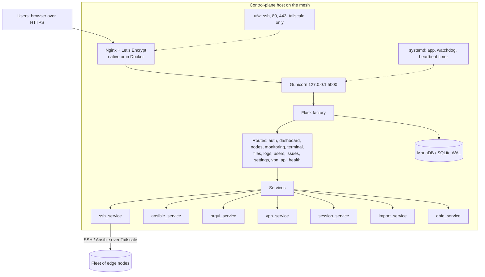
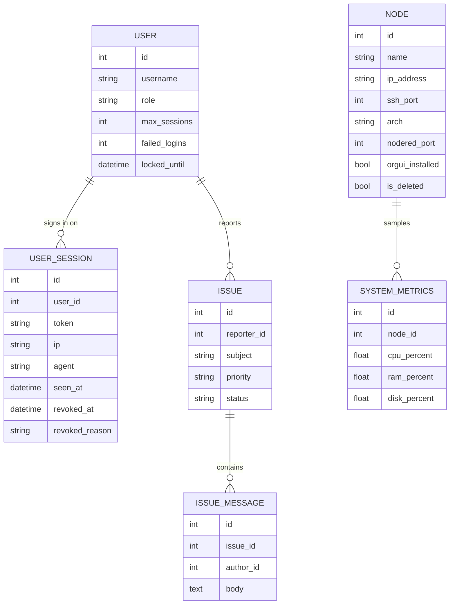

# Architecture

EdgeShell is a Flask application built with the app-factory pattern. One control
plane process manages many nodes over SSH and Ansible. State lives in a SQL
database: MariaDB in production (`run.py` on a server, or the production
Compose stack), SQLite with WAL for local development and the single-container
image.

## Components

## Data model

Stand-alone tables: `activity_logs` (audit of user actions), `node_logs`,
`deployments` (per-node results of file deploys), `vpn_status` (heartbeat
samples), `service_events` (every service start and stop with its reason) and
`settings` (key/value). On MariaDB, the views `v_activity_local`,
`v_service_events_local` and `v_user_sessions` show timestamps in `DISPLAY_TZ`.

## Key decisions

- App factory so the app can be created per config (development, production,
  testing) and imported by both `run.py` and `wsgi.py`.
- SQLite WAL for concurrent multi-user reads with a single writer, enabled via
  an engine `connect` event that is a no-op on Postgres/MariaDB.
- Services isolate side effects (SSH, Ansible, VPN) from routes so they are
  testable and swappable.
- VPN behind an interface so Tailscale can be replaced by WireGuard without
  touching routes or templates.

See the [ADRs](adr/) for the reasoning behind each.

## Monitoring contract

`POST /monitoring/poll` returns, per node, `{ success, metrics, node_name }`.
The `metrics` object carries `cpu_percent`, `mem_percent`, `disk_percent`,
`load_1/5/15`, `uptime`, `temperature`, `net_rx_bytes`, `net_tx_bytes`,
`docker_running`, `nodered_running`, `collected_at`. The frontend unwraps
`metrics` and renders. The dashboard uses `GET /monitoring/fleet-summary`, a
flat aggregate for the overview cards.
