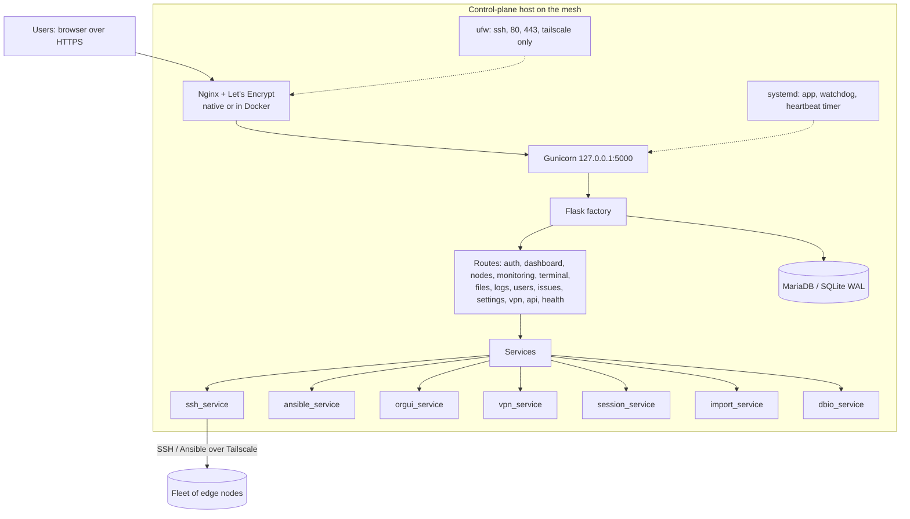
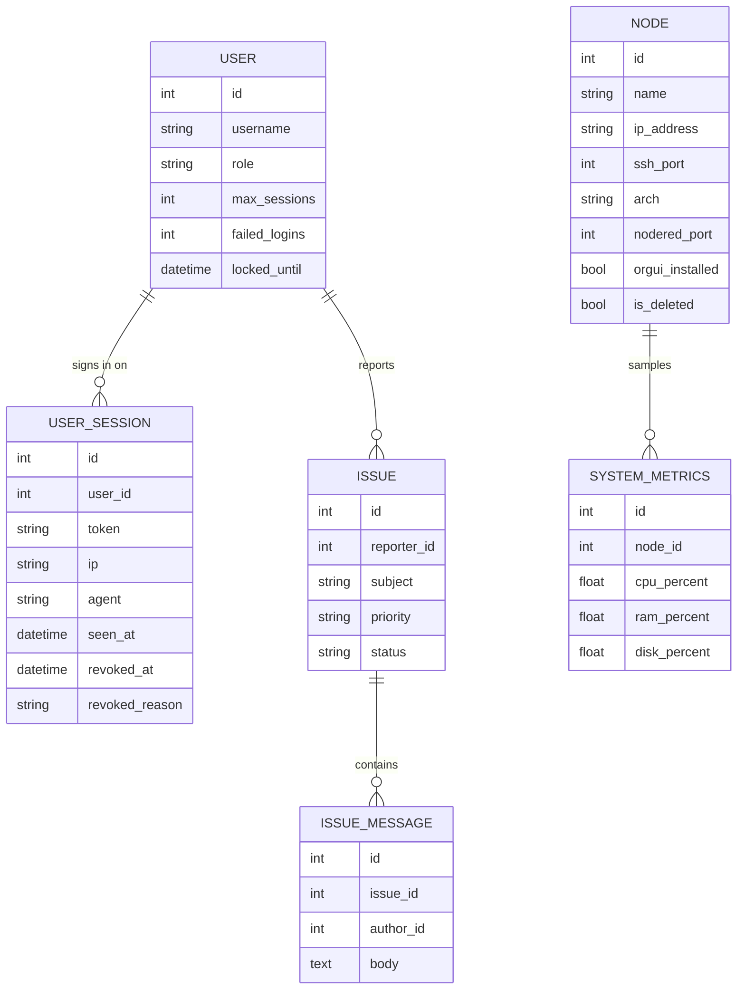

# Architecture

EdgeShell is a Flask application built with the app-factory pattern. One control
plane process manages many nodes over SSH and Ansible. State lives in a SQL
database: MariaDB in production (`run.py` on a server, or the production
Compose stack), SQLite with WAL for local development and the single-container
image.

## Components

## Data model

Stand-alone tables: `activity_logs` (audit of user actions), `node_logs`,
`deployments` (per-node results of file deploys), `vpn_status` (heartbeat
samples), `service_events` (every service start and stop with its reason) and
`settings` (key/value). On MariaDB, the views `v_activity_local`,
`v_service_events_local` and `v_user_sessions` show timestamps in `DISPLAY_TZ`.

## Key decisions

- App factory so the app can be created per config (development, production,
  testing) and imported by both `run.py` and `wsgi.py`.
- SQLite WAL for concurrent multi-user reads with a single writer, enabled via
  an engine `connect` event that is a no-op on Postgres/MariaDB.
- Services isolate side effects (SSH, Ansible, VPN) from routes so they are
  testable and swappable.
- VPN behind an interface so Tailscale can be replaced by WireGuard without
  touching routes or templates.

See the [ADRs](adr/) for the reasoning behind each.

## Monitoring contract

`POST /monitoring/poll` returns, per node, `{ success, metrics, node_name }`.
The `metrics` object carries `cpu_percent`, `mem_percent`, `disk_percent`,
`load_1/5/15`, `uptime`, `temperature`, `net_rx_bytes`, `net_tx_bytes`,
`docker_running`, `nodered_running`, `collected_at`. The frontend unwraps
`metrics` and renders. The dashboard uses `GET /monitoring/fleet-summary`, a
flat aggregate for the overview cards.

## Metrics collection

A background thread in the web process (`app/services/collector.py`,
started from `wsgi.py`) keeps the fleet's metrics fresh; no web request waits
on SSH.

| Step | What happens |
|---|---|
| Connection | One SSH connection per node, kept open with keepalives and reused. Edited credentials always get a fresh login |
| Command | One shell command reads `/proc/stat` (twice, 0.2 s apart, for CPU), `/proc/loadavg`, `/proc/meminfo`, `df`, `/proc/uptime`, the temperature, network counters and the Docker and Node-RED state |
| Fan-out | All due nodes at once, `COLLECTOR_WORKERS` (48) in parallel, every `COLLECTOR_INTERVAL` (30 s) |
| Storage | Only the collector thread writes: the node row, plus one history sample per node per minute (online, offline or login failed) |
| Failures | `auth` (wrong username or password: card shows Fix login, retried every 10 min), `unreachable` (backs off up to 5 min), `error` |

Measured on a 122-node Tailscale fleet:

| | Before | Now |
|---|---|---|
| One fleet refresh | about 11 min, node after node, new login each time | 28 s cold, 5 to 8 s warm |
| Per node | 2 s (TCP 0.3 s, login 0.9 s, Python script on the node 0.9 s) | 0.6 to 0.7 s (one round trip plus the CPU sample) |

The remaining time per node is network latency to the device, which a
faster language would not remove; the collector is Python by design. Run
`tools/perf.py` to time every page, API and action against a simulated fleet.

## Node login policy

| Event | What EdgeShell does |
|---|---|
| Password rejected | Retry once after 10 minutes; at `LOGIN_PAUSE_AFTER_FAILURES` (2) in a row the node is paused |
| Tailscale SSH refuses (browser check) | Paused at once: repeating cannot succeed |
| Paused | No automatic or bulk logins (collector, Refresh All, Test All, fleet terminal, deploys, scans). Stored on the node, so restarts do not retry |
| Every `LOGIN_RECHECK_MINUTES` (30) | Read each paused node's SSH banner (TCP, no login). Changed server: one new attempt. One canary login for the Tailscale group; success resumes the group |
| Person acts | Test on the card or Fix login: one attempt. Retry paused logins: one attempt each, a new failure pauses again |

All SSH logins go through `ssh_service.connect` (closes failed connections,
names Tailscale SSH refusals); `tests/test_login_policy.py` fails the build if
code opens SSH any other way.

## Hot database and data lake

| | Hot database (`mariadb`) | Data lake (`mariadb-lake`) |
|---|---|---|
| Role | every write and live read | a live replica that keeps everything |
| Feeds | the app | the hot database's binary log (row based, `edgeshell` database only) |
| Reads | nodes, live metrics, sessions | exports, history, events, activity (when caught up) |
| Retention | raw samples `METRICS_RETENTION_DAYS`, events `EVENT_RETENTION_DAYS`, optional policy for the rest | none: keeps every row |

`app/services/lake.py`: the app writes a heartbeat row on the hot database
every minute and reads it back from the lake, so replication lag is measured
end to end with no special privileges. `lake.reader()` hands out a lake session
when the lag is under 10 minutes, else the hot session. `lake.purge()` deletes
from a fixed list of history tables only after checking the lake is less than
3 minutes behind and holds the newest row to be deleted (replication applies
changes in order), and runs the delete with `sql_log_bin=0` so it never reaches
the lake. `tools/lake_e2e.py` proves this against two real MariaDB servers in
CI.

## Public API

`/api/v1` (`app/routes/api.py`, reference in [docs/API.md](API.md)). Each route
is declared once with its scope, query parameters and JSON schema; the same
declaration validates requests and generates `/api/v1/openapi.json`. Bearer
credentials (`app/services/api_auth.py`, table `api_tokens`) are challenges,
sessions and service keys, stored as SHA-256 hashes. They are resolved before
the browser-session check, so a token request never needs or creates a
cookie. Permissions are the role intersected with the scopes; a cookie may only
read. `node_events` is the append-only event feed the API serves with a cursor.

## Long-term history and the stats export

| Table | What | Kept |
|---|---|---|
| `system_metrics` | One sample per active node per minute: state (online, offline, auth_failed), CPU, memory, disk, temperature, load, uptime, network counters | `METRICS_RETENTION_DAYS` (default 14) |
| `metrics_hourly` | Rolled up every hour from the samples: samples per state (uptime), average and peak of each metric, reboots (uptime going down), network bytes | for good, about 1.3 million rows a year for 150 nodes |

The rollup runs in the collector thread (`app/services/history.py`); a first
backfill after an upgrade is spread over passes of 24 hours each. The
dashboard's **Export stats** starts a background job (`jobs.run_task`) that
brings the rollup up to date, reads the chosen period (24 hours to a year),
category and detail (hourly, daily or one row per node) and writes a CSV. The
page polls the job for its progress bar, then downloads the file; an export is
kept for an hour and only its owner can download it. Every row carries the
node's category, type, location and environment, so a separate pipeline can
load the files into a data lake and train health-prediction models on them.

## Device categories

Categories group nodes by `node_type` for the dashboard (stored as JSON in
the `settings` table, key `dashboard_categories`, edited by administrators on
the dashboard). Each has a name, node types, an icon and an SLA target. The
fleet summary returns the categories with every node's type; the dashboard
computes each card's counts, availability and averages in the browser, so
switching categories is instant.

## Terminals

| | Fleet terminal (Terminal page) | Node terminal (card button) |
|---|---|---|
| Transport | HTTP POST, results streamed as NDJSON, one line per node | WebSocket `/ws/nodes/<id>/shell` (flask-sock) |
| On the node | one command per node over the collector's pooled SSH connection | an interactive shell on a real PTY (`invoke_shell`) |
| Targets | online nodes only; the rest are listed as skipped | one node |
| sudo | the stored password is fed on stdin (not on the command line, no echo) | prompts like any SSH session |

Each WebSocket terminal holds one Gunicorn thread (`GUNICORN_THREADS`, 32 by
default). nginx forwards `/ws/` with the Upgrade headers; the app pings every
25 s so idle shells survive proxies.
