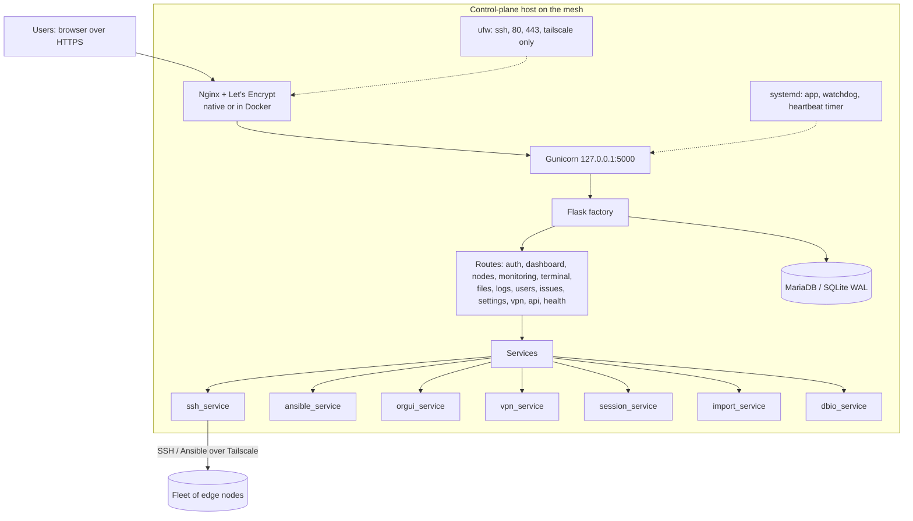
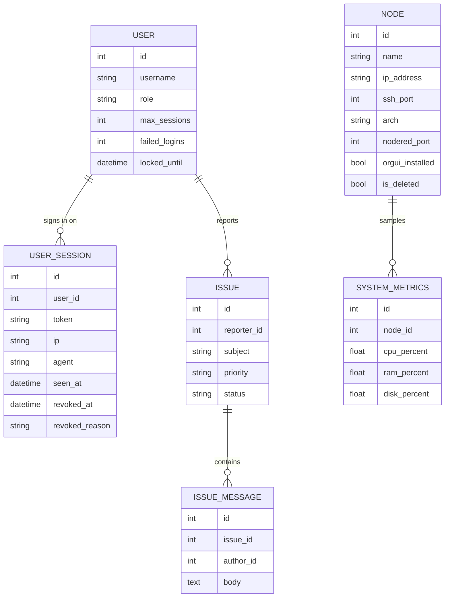

# Architecture

EdgeShell is a Flask application built with the app-factory pattern. One control
plane process manages many nodes over SSH and Ansible. State lives in a SQL
database: MariaDB in production (`run.py` on a server, or the production
Compose stack), SQLite with WAL for local development and the single-container
image.

## Components

## Data model

Stand-alone tables: `activity_logs` (audit of user actions), `node_logs`,
`deployments` (per-node results of file deploys), `vpn_status` (heartbeat
samples), `service_events` (every service start and stop with its reason) and
`settings` (key/value). On MariaDB, the views `v_activity_local`,
`v_service_events_local` and `v_user_sessions` show timestamps in `DISPLAY_TZ`.

## Key decisions

- App factory so the app can be created per config (development, production,
  testing) and imported by both `run.py` and `wsgi.py`.
- SQLite WAL for concurrent multi-user reads with a single writer, enabled via
  an engine `connect` event that is a no-op on Postgres/MariaDB.
- Services isolate side effects (SSH, Ansible, VPN) from routes so they are
  testable and swappable.
- VPN behind an interface so Tailscale can be replaced by WireGuard without
  touching routes or templates.

See the [ADRs](adr/) for the reasoning behind each.

## Monitoring contract

`POST /monitoring/poll` returns, per node, `{ success, metrics, node_name }`.
The `metrics` object carries `cpu_percent`, `mem_percent`, `disk_percent`,
`load_1/5/15`, `uptime`, `temperature`, `net_rx_bytes`, `net_tx_bytes`,
`docker_running`, `nodered_running`, `collected_at`. The frontend unwraps
`metrics` and renders. The dashboard uses `GET /monitoring/fleet-summary`, a
flat aggregate for the overview cards.

## Metrics collection

A background thread in the web process (`app/services/collector.py`,
started from `wsgi.py`) keeps the fleet's metrics fresh; no web request waits
on SSH.

| Step | What happens |
|---|---|
| Connection | One SSH connection per node, kept open with keepalives and reused. Edited credentials always get a fresh login |
| Command | One shell command reads `/proc/stat` (twice, 0.2 s apart, for CPU), `/proc/loadavg`, `/proc/meminfo`, `df`, `/proc/uptime`, the temperature, network counters and the Docker and Node-RED state |
| Fan-out | All due nodes at once, `COLLECTOR_WORKERS` (48) in parallel, every `COLLECTOR_INTERVAL` (30 s) |
| Storage | Only the collector thread writes: the node row, plus a history row at most once a minute |
| Failures | `auth` (wrong username or password: card shows Fix login, retried every 10 min), `unreachable` (backs off up to 5 min), `error` |

Measured on a 122-node Tailscale fleet:

| | Before | Now |
|---|---|---|
| One fleet refresh | about 11 min, node after node, new login each time | 28 s cold, 5 to 8 s warm |
| Per node | 2 s (TCP 0.3 s, login 0.9 s, Python script on the node 0.9 s) | 0.6 to 0.7 s (one round trip plus the CPU sample) |

The remaining time per node is network latency to the device, which a
faster language would not remove; the collector is Python by design. Run
`tools/perf.py` to time every page, API and action against a simulated fleet.

## Device categories

Categories group nodes by `node_type` for the dashboard (stored as JSON in
the `settings` table, key `dashboard_categories`, edited by administrators on
the dashboard). Each has a name, node types, an icon and an SLA target. The
fleet summary returns the categories with every node's type; the dashboard
computes each card's counts, availability and averages in the browser, so
switching categories is instant.
