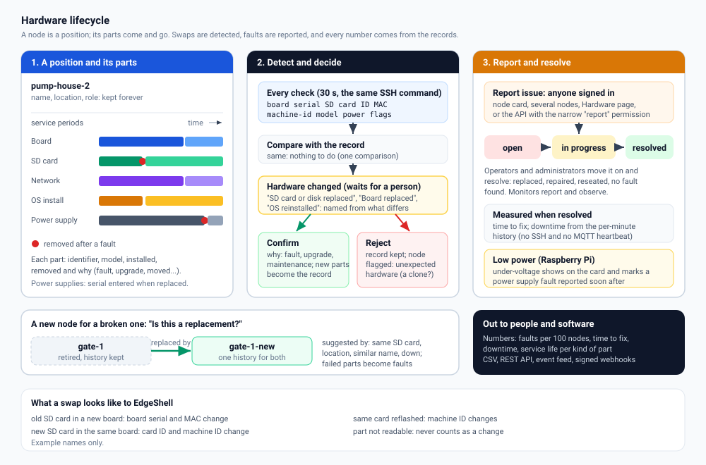

# Hardware lifecycle: faults, replacements and parts

EdgeShell keeps a hardware log for every node and for the whole fleet: which
parts serve each node, when they were replaced and why, every fault reported,
how long fixes take, and how long each kind of part lasts. Site engineers and
monitoring staff report issues in two clicks; operators resolve them; other
software reports and listens through the API and webhooks.



Design decisions: [ADR 0015](adr/0015-hardware-lifecycle.md).

## Contents

1. [A node is a position, a device is hardware](#a-node-is-a-position-a-device-is-hardware)
2. [What EdgeShell reads](#what-edgeshell-reads)
3. [Replacements are detected](#replacements-are-detected)
4. [A new node for a broken one](#a-new-node-for-a-broken-one)
5. [Reporting and resolving faults](#reporting-and-resolving-faults)
6. [Who can do what](#who-can-do-what)
7. [Where to look](#where-to-look)
8. [The numbers](#the-numbers)
9. [API](#api)
10. [Webhooks](#webhooks)
11. [Categories](#categories)
12. [Limits and privacy](#limits-and-privacy)

## A node is a position, a device is hardware

A **node** is a place in the fleet: its name, location, category and role, for
example `pump-house-2`. It keeps one history forever.

The **parts** that serve it change over time: the board, the SD card or disk,
the network adapter, the OS install, the power supply. Each part has a service
period on the node: from when it was installed to when it was removed, and
why (`fault`, `upgrade`, `maintenance`, `moved` to another node, `retired`).

Replacing hardware never creates a new node and never throws the old one away:
it closes one part's service period and opens the next.

## What EdgeShell reads

The collector already checks every node every 30 seconds over one open SSH
connection. The same command also reads the hardware identity, with plain
reads only (no root, no packages, about a millisecond):

| Part | Raspberry Pi and other ARM boards | Other Linux machines |
|---|---|---|
| Board | serial number from the device tree | DMI product serial, when readable |
| SD card or disk | the SD card's built-in ID (CID) | the disk serial |
| Network adapter | MAC address of the first physical interface | the same |
| OS install | `/etc/machine-id` (a fresh OS image changes it) | the same |

plus the board model, card name and size, the OS name, and on Raspberry Pi the
power flags (`vcgencmd get_throttled`). A part that cannot be read is left
empty and never counts as a change. Values are reduced to a safe character set
before they are stored or shown.

The first successful read records the **inventory**. Parts that were in service
before EdgeShell first saw them are marked "before" / "at least", so service
lives are never overstated.

## Replacements are detected

When a part differs from the record, the node shows **Hardware changed** and
the change waits for a decision. EdgeShell names what happened:

| What the engineer did | What changes | Shown as |
|---|---|---|
| Moved the old SD card into a new board | board serial, MAC address | Board replaced (the same SD card or disk in new hardware) |
| Put a new SD card in the same board | SD card ID, machine ID | SD card or disk replaced |
| Reflashed the same card | machine ID | Operating system reinstalled on the same hardware |
| New board and new SD card | everything | Board and SD card or disk replaced |
| Swapped a USB network adapter | MAC address only | Network adapter changed |

When a part was seen on another node before (an SD card taken from a broken
node), the change says so, and confirming it closes that part on the other node
as `moved`.

An operator or administrator then:

- **Confirms** it, with the reason: *a part failed* (counted as a fault: an open
  report of the node can be resolved with it, or a fault record is created),
  *upgrade*, *planned maintenance* or *other*. The new parts become the record.
- **Rejects** it as unexpected. The record stays, and the node is flagged
  **Unexpected hardware** until its hardware matches the record again. This is
  what a cloned SD card running on other hardware looks like.

If the hardware goes back to the record before anyone decides (a card put in
for a minute), the change closes by itself as *reverted*.

## A new node for a broken one

When you add a node that looks like the replacement of an existing one,
EdgeShell asks: **Is this a replacement for an existing node?** It suggests
nodes that are down and share the location, have a similar name or type, or,
strongest of all, hold one of the new node's parts (the old SD card).

- **Yes, it replaces X**: choose what failed on X (board, power supply...).
  X is **retired**: kept with its whole history, no longer checked, shown with
  "Retired: replaced by ...". The new node shows "replaces X", and its hardware
  history includes X's parts, faults and timeline. Failed parts are recorded as
  faults of X, so they count in the numbers.
- **No, it is a new node**: not asked again.

The question also appears on the new node's card ("Replacement?") until it is
answered, and after its first hardware read if a likely predecessor shows up
then.

## Reporting and resolving faults

**Report issue** is on every node card, in the bulk bar for several selected
nodes, on the Hardware page (pick any nodes), and in the API. A report has a
component (from the [categories](#categories)), a short symptom, a severity
(low, normal, high, critical), optional details and when it started.

A fault is **open**, **in progress** or **resolved**. Operators and
administrators mark it in progress, add notes and resolve it with one of:
`replaced`, `repaired`, `reseated`, `no_fault_found`, `other`. Resolving
records:

- the **time to fix**: from when it started (or was reported) to the fix
- the **downtime**: minutes the node was fully down in that time (no SSH and no
  MQTT heartbeat), from the per-minute history
- for parts EdgeShell cannot read (power supply, sensors...), *replaced* with
  the new part's serial starts that part's service life

A resolved fault can be reopened. Every step is in the fault's timeline, the
node's hardware history and the activity log.

**Low power.** Raspberry Pi boards report under-voltage. The node card shows
**Low power** for a day, the hardware timeline logs it (once a day while it
lasts), and a power supply fault reported within a week afterwards is marked,
so you can see how often the warning came first.

## Who can do what

| | Monitor | Operator | Administrator |
|---|---|---|---|
| See hardware history, faults, parts, numbers; export CSV | yes | yes | yes |
| Report issues (web and API, `report` permission) | yes | yes | yes |
| Mark in progress, add notes, resolve, reopen | | yes | yes |
| Confirm or reject detected changes | | yes | yes |
| Answer "is this a replacement?" | | yes | yes |
| Edit fault categories, manage webhooks | | | yes |

Monitors report and observe; the server enforces this on every request.

## Where to look

- **Node card**: badges for *Hardware changed*, *Unexpected hardware*,
  *Low power*, *N open faults*, *Retired* and *replaces ...*; the **Hardware**
  and **Report issue** buttons.
- **Hardware history** (the Hardware button): parts in service and past parts
  with their service periods, detected changes, faults and the timeline,
  including the nodes this one replaced.
- **Hardware page** (sidebar): open faults, the fleet tiles, tabs for faults,
  detected changes, parts in service and the numbers, a guide, and (for
  administrators) categories and webhooks. The sidebar badge counts open faults
  and changes waiting for a decision.
- **CSV**: faults, all parts with their service periods, and changes.

## The numbers

On the Hardware page (Numbers tab) and `GET /api/v1/hardware/stats`:

| Number | Definition |
|---|---|
| Faults per 100 nodes, 30 days | faults reported in the last 30 days / nodes in the fleet (not retired, not in the Recycle Bin) x 100. Comparable as the fleet grows |
| Faults by component, per month | counts per component category for the period, and for each of the last 12 months |
| Mean and median time to fix | over faults resolved in the period: resolved time minus start (or report) time. Records created automatically with a confirmed replacement are left out |
| Downtime caused | sum of the downtime of the resolved faults, in hours |
| Replacements | confirmed hardware changes plus node replacements in the period, also per 100 nodes |
| Service life | per kind of part: how many were removed because they failed, the mean days they served ("at least" when some were in service before EdgeShell saw them), how many are in use and their median age |
| Nodes and locations with most faults | the top 10 of each in the period |
| Power faults flagged by low power first | power faults whose node reported under-voltage in the week before |

## API

All under `/api/v1`, documented in [API.md](API.md) and in
`GET /api/v1/openapi.json`.

| Method and path | Permission | Purpose |
|---|---|---|
| `GET /hardware/faults` | read | List faults: `status` (`open`, `in_progress`, `resolved`, `unresolved`), `component`, `node_id`, `since`, paging |
| `POST /hardware/faults` | **report** | Report a fault: `node_id` or `node_name`, `component`, `symptom`, optional `description`, `severity`, `started_at` |
| `GET /hardware/faults/{fault_id}` | read | One fault and its timeline |
| `PATCH /hardware/faults/{fault_id}` | write | `action`: `progress`, `note`, `resolve` (with `resolution`, optional `new_serial`), `reopen` |
| `GET /hardware/categories` | read | The component categories |
| `GET /hardware/stats` | read | The numbers above; `days` (7 to 730) |
| `GET /hardware/changes` | read | Detected changes; `status` |
| `POST /hardware/changes/{change_id}/decision` | write | `decision`: `confirm` (with `reason`, optional `fault_id`) or `reject` |
| `GET /nodes/{node_id}/hardware` | read | A node's parts, changes, faults, timeline and lineage |
| `POST /nodes/{node_id}/replaces` | write | Link a replacement: `replaces_node_id`, optional `failed` categories and `note` |

`report` is a narrow permission every role has: a key with only `report` (and
`read`) can file faults from a site engineer's form, a ticketing tool or a
maintenance app, and nothing else. Hardware faults, detected changes and node
replacements also appear in the event feed (`GET /api/v1/events`, kinds
`hardware_fault`, `hardware_changed`, `node_replaced`).

Report a fault with a service key:

```bash
curl -s https://fleet.example.com/api/v1/hardware/faults \
  -H "Authorization: Bearer $EDGESHELL_KEY" -H "Content-Type: application/json" \
  -d '{"node_name": "pump-house-2", "component": "power", "symptom": "No lights on the board", "severity": "high"}'
```

## Webhooks

Administrators add webhooks on the Hardware page (Settings). Choose the events:

| Event | When |
|---|---|
| `hardware.fault_reported` | a fault is reported |
| `hardware.fault_updated` | a fault is marked in progress, noted or reopened |
| `hardware.fault_resolved` | a fault is resolved |
| `hardware.change_detected` | a hardware change is detected |
| `hardware.change_confirmed` | a change is confirmed |
| `hardware.change_rejected` | a change is rejected (unexpected hardware) |
| `node.replaced` | a node is linked as the replacement of another |

Each delivery is a JSON `POST`:

```json
{"event": "hardware.fault_reported", "occurred_at": "2026-10-17T08:00:00Z",
 "data": {"id": 42, "node_name": "pump-house-2", "component": "power", "component_label": "Power supply",
          "symptom": "No lights on the board", "severity": "high", "status": "open", "reported_by": "site-eng"}}
```

with these headers:

| Header | Value |
|---|---|
| `X-EdgeShell-Event` | the event name |
| `X-EdgeShell-Delivery` | a unique id, the same on retries (de-duplicate on it) |
| `X-EdgeShell-Timestamp` | Unix seconds |
| `X-EdgeShell-Signature` | `sha256=` + hex HMAC-SHA256 of `"<timestamp>.<raw body>"` with the webhook's secret |

The secret is shown once, when the webhook is added, and stored encrypted.
Check the signature and refuse old timestamps:

```python
import hashlib, hmac, time

def verify(secret: str, headers, body: bytes, max_age=300) -> bool:
    ts = headers['X-EdgeShell-Timestamp']
    if abs(time.time() - int(ts)) > max_age:
        return False                                   # an old delivery replayed
    mac = hmac.new(secret.encode(), ts.encode() + b'.' + body, hashlib.sha256).hexdigest()
    return hmac.compare_digest('sha256=' + mac, headers['X-EdgeShell-Signature'])
```

```javascript
const crypto = require('crypto');
function verify(secret, headers, rawBody) {
  const ts = headers['x-edgeshell-timestamp'];
  if (Math.abs(Date.now() / 1000 - Number(ts)) > 300) return false;
  const mac = 'sha256=' + crypto.createHmac('sha256', secret).update(ts + '.').update(rawBody).digest('hex');
  return crypto.timingSafeEqual(Buffer.from(mac), Buffer.from(headers['x-edgeshell-signature']));
}
```

Deliveries run in the background, time out after a few seconds, follow no
redirects, and are retried twice on network errors and 5xx answers. After 50
failures in a row a webhook switches itself off. **Test** sends a
`webhook.test` delivery; **Deliveries** shows the last attempts.

EdgeShell refuses webhook addresses that point back into its own networks:
loopback, link-local (including the cloud metadata service), multicast and
reserved ranges always; private and carrier-grade NAT ranges (a LAN, the
Tailscale mesh) unless `WEBHOOK_ALLOW_PRIVATE=true` is set. Use `https://`
(plain `http://` only for private receivers, when allowed). Credentials do not
belong in the address.

## Categories

The components people choose when they report. The defaults are power supply,
SD card or storage, board, network, sensor or peripheral, enclosure or
environment, and other. Administrators rename or hide them and add their own
(batteries, modems, cameras...) on the Hardware page. Keys are lowercase
letters, digits and `_`; at most 30 categories.

## Limits and privacy

- Serials, card IDs and MAC addresses identify hardware, not people. They stay
  in EdgeShell's database and its exports, readable by signed-in users.
- A board serial is not a secret: it detects cloned SD cards and swapped
  parts, and raises the bar, but an attacker with root on a node can read it.
  Signed per-node identities for the MQTT heartbeat agent are planned
  separately.
- On x86 machines the board serial is usually readable only by root; the MAC
  address then stands in for the board.
- Containers and some virtual machines have no stable board or disk identity;
  their MAC address and machine ID are used.
