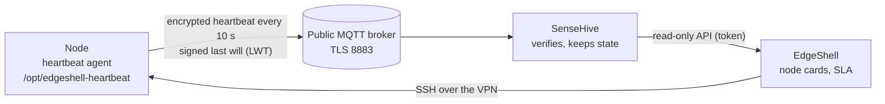

# MQTT heartbeat: VPN-independent node liveness

EdgeShell reaches nodes over SSH through a VPN. When the VPN glitches, every
node looks offline although it is fine, and that time used to count as
downtime. The MQTT heartbeat adds a **second, independent signal**: a small
agent on each node reports "alive" every 10 seconds over a public MQTT broker
on the internet, encrypted and authenticated. A node counts as **up** when SSH
reaches it **or** a verified heartbeat arrived, so availability (SLA) is
measured precisely.



| Part | Where | Role |
|---|---|---|
| Heartbeat agent | every node, `/opt/edgeshell-heartbeat` ([repository](https://github.com/855princekumar/mqtt-heartbeat-service)) | publishes heartbeats and a signed last will; reloads `config.yaml` on the fly |
| SenseHive | a container in the EdgeShell stack ([repository](https://github.com/855princekumar/sense-hive)) | verifies every message, keeps per-node state (SQLite), serves it read-only |
| EdgeShell | the app | installs the agent, pushes settings, reads SenseHive, shows status, counts uptime |

## Contents

1. [What you see](#what-you-see)
2. [Set it up](#set-it-up)
3. [Install the agent on nodes](#install-the-agent-on-nodes)
4. [Change settings on every node (hot reload)](#change-settings-on-every-node-hot-reload)
5. [How uptime is counted](#how-uptime-is-counted)
6. [Opening SenseHive](#opening-sensehive)
7. [Security on a public broker](#security-on-a-public-broker)
8. [Roles](#roles)
9. [Operate and troubleshoot](#operate-and-troubleshoot)

## What you see

On every node card (all roles):

| Badge | Meaning |
|---|---|
| **heartbeat** (green) | verified heartbeats are arriving |
| **LWT offline** (red) | the node's last will arrived: its agent's connection dropped (node down, or its internet) |
| **heartbeat silent** (amber) | no heartbeat and no last will: usually the broker or the internet path, not the node |
| **no heartbeat agent** (grey) | the node is reachable but has no agent; uptime relies on SSH only. Administrators install it in Fleet Setup |

Every change of heartbeat state is an event in the event feed
(`GET /api/v1/events`, kind `heartbeat_changed`). Administrators also get a
**SenseHive** link in the sidebar (new tab) with the full heartbeat page.

### Heartbeat history

Click a node's heartbeat badge (every role) for its history, read from
SenseHive by EdgeShell's server with its token (the browser never talks to
SenseHive):

| Period | Chart |
|---|---|
| 1 minute, 1 hour, 1 day | seconds between consecutive heartbeats; breaks shaded red, last wills marked, the usual interval dashed |
| 7 days, 30 days | uptime per hour |

Under the chart: uptime, heartbeats received, the usual interval, the longest
break, the number of breaks, the median delivery delay and the list of breaks.
A break is a gap longer than 2.5 times the node's usual interval.

**CSV export**: **Export CSV** in the history (that node and period; every
role), or tick nodes on Node Fleet and use **Export heartbeats** in the
bulk-action bar (operators and administrators): every heartbeat, online
minutes or status changes, for the last hour, day, 7 or 30 days. Every export
is in the activity log.

| Endpoint (signed-in session) | Returns |
|---|---|
| `GET /nodes/<id>/heartbeat/history?range=1m\|1h\|1d\|7d\|30d` | chart data and figures for one node |
| `GET /nodes/heartbeat/export.csv?ids=1,2&what=beats\|minutes\|events&period=1h\|1d\|7d\|30d` | CSV for one or several nodes |

Needs SenseHive 1.5 or newer (`SENSEHIVE_TAG`), which keeps every heartbeat for
48 hours and online minutes for 30 days.

## Set it up

Docker stack, on the host, in the folder with `compose.yaml` (1.9.0 or later):

```bash
# Two secrets, generated once, kept only in .env
echo "HEARTBEAT_MASTER_KEY=$(openssl rand -hex 32)" >> .env
echo "SENSEHIVE_API_TOKEN=$(openssl rand -hex 32)" >> .env
docker compose up -d
```

- `HEARTBEAT_MASTER_KEY`: gives each node its own keys at install time. It
  stays on the server (EdgeShell and SenseHive); **it is never sent to a node**.
- `SENSEHIVE_API_TOKEN`: lets EdgeShell read SenseHive's API.
- Optional: `HEARTBEAT_BROKER` (default `broker.hivemq.com`), `HEARTBEAT_PORT`
  (8883), `HEARTBEAT_TLS` (true) as the defaults for new installs.

SenseHive keeps its data in `./data/sensehive` (kept across restarts and
upgrades). Set `SENSEHIVE_ADMIN_PASSWORD` in `.env` before the first start, or
open SenseHive once from the sidebar and change its password (`admin` /
`admin123`). See [Opening SenseHive](#opening-sensehive).

## Install the agent on nodes

**Node Fleet, Fleet Setup, Heartbeat agent, Install on missing** (administrators).
It runs as a background job, 8 nodes at a time, with live progress. Per node:

1. EdgeShell uploads the agent (a pinned copy inside the EdgeShell image; no
   download from the internet), this node's `agent.env` (its name and keys) and
   the fleet `config.yaml` into a private temporary folder.
2. `install.sh` installs the OS packages (`python3-paho-mqtt`, `python3-yaml`,
   `python3-cryptography`), creates the unprivileged user `hbagent`, puts the
   files in `/opt/edgeshell-heartbeat` and starts the hardened systemd service
   `edgeshell-heartbeat`; the temporary folder is removed.
3. The agent identifies itself by the **EdgeShell node name**, so its heartbeats
   land on exactly that node: no duplicates, no overwriting another node.

Try one node first (select it, then install), then the rest. The Fleet Setup
scan shows which nodes have the agent running.

## Change settings on every node (hot reload)

**Fleet Setup, Heartbeat settings**: broker, port, TLS, interval, then **Save and
push to fleet**. EdgeShell writes the same `config.yaml` to every node with the
agent (atomically). Each agent:

- applies a new interval at once, without reconnecting;
- switches to a new broker cleanly (disconnect, connect, new last will), so no
  false "offline";
- ignores a broken or invalid file and keeps its last good settings, so a bad
  push can never stop heartbeats.

`config.yaml` holds no secrets. A node's keys (`agent.env`) are never part of a
push.

## Opening SenseHive

SenseHive lives at `https://<your domain>/sensehive/` and is for administrators
only. nginx asks EdgeShell about every request before SenseHive sees it:

| How you arrive | What happens |
|---|---|
| **SenseHive** button in the EdgeShell sidebar | Opens in a new tab straight away: the button posts this page's CSRF token, and EdgeShell gives the browser a SenseHive pass |
| Typed, bookmarked or linked `/sensehive/` | EdgeShell asks for your **2FA code** first (or your sign-in when you are not signed in); wrong codes count toward the account lockout |
| Not an administrator | Sent back to EdgeShell; SenseHive is never reached |
| A bot or scanner | Sent to EdgeShell's sign-in; SenseHive's login page is never shown to it |

Then SenseHive asks for its **own** login.

- **The pass:** a signed cookie, HttpOnly, SameSite=Strict, only for `/sensehive/`, valid for 4 hours. It is bound to your EdgeShell session: copied to another browser it is useless, and it dies when you sign out.
- **Cookies stay apart:** nginx passes only SenseHive's cookie to SenseHive, never EdgeShell's session or pass, and SenseHive's own cookie is limited to `/sensehive/`.
- **SenseHive's own sign-in:**
  - salted, slow password hashes;
  - lockout after 5 failures per user and per address (15 minutes);
  - a new session at each sign-in;
  - cross-site requests refused;
  - nginx rate limits its form posts.
- **First password:** set `SENSEHIVE_ADMIN_PASSWORD` in `.env` before the first start, or change `admin123` at the first sign-in.

## How uptime is counted

| | Before | With the heartbeat |
|---|---|---|
| Dashboard availability (SLA) | nodes reachable over SSH now | nodes reachable over SSH **or** with a verified heartbeat in the last 40 s |
| History, stats export (`uptime_percent`) | minutes the node answered over SSH | minutes the node answered over SSH **or** sent a verified heartbeat |
| VPN gaps | counted as downtime | counted as up, and recorded separately per hour (`heartbeat_only`) |

A node that is really down sends no heartbeat (its last will arrives within
seconds), so real outages are still counted.

## Security on a public broker

Anyone can read and publish on a public broker, so nothing on it is trusted:

- **Encrypted and authenticated** (AES-256-GCM): the message says only the node
  name, a time, a counter, the kind and the agent version. No addresses, no
  credentials, no metrics, never anything from the node's data.
- **Per-node keys**: each node can only speak for itself; a stolen node key
  cannot fake another node.
- **Rotating topics**: random-looking, changing every ten minutes (derived from a
  key, like a 2FA code); the MQTT client id is random. Nothing on the broker
  names EdgeShell, the fleet or a node.
- **No replays, no fake "offline"**: times must be fresh and increasing; a last
  will only counts for the connection it belongs to.
- **TLS** to the broker with certificate verification.
- **On the node**: the agent runs as `hbagent` with systemd hardening (read-only
  system, no privileges, memory and CPU caps); `agent.env` is readable only by
  root and the agent.
- **SenseHive's API** is read-only (GET), needs a 32+ character token, and is not
  published outside the Docker network.

Details: [ADR 0013](adr/0013-mqtt-heartbeat.md) and the
[protocol](https://github.com/855princekumar/mqtt-heartbeat-service/blob/main/heartbeat_protocol.py).

## Roles

| Action | Admin | Operator | Monitor |
|---|---|---|---|
| See heartbeat and LWT status on node cards | yes | yes | yes |
| Install the agent, push heartbeat settings | yes | - | - |
| Open SenseHive | yes | - | - |

## Operate and troubleshoot

| Symptom | Check |
|---|---|
| Every node "heartbeat silent" | SenseHive's connection to the broker: SenseHive, Heartbeats page; `docker compose logs sensehive` |
| One node "LWT offline" but SSH works | the agent on that node: `systemctl status edgeshell-heartbeat`, `journalctl -u edgeshell-heartbeat -n 50` |
| Install fails at the packages step | the node needs internet for `apt` once |
| "HEARTBEAT_MASTER_KEY is not set" in Fleet Setup | add it to `.env` (see above) and `docker compose up -d` |

Rotating the master key: set a new `HEARTBEAT_MASTER_KEY`, `docker compose up -d`,
then reinstall the agent on every node (Fleet Setup). Until a node is
reinstalled its heartbeats are rejected (it shows silent), nothing else breaks.

Removing the agent from a node (the installer is not kept on the node):

```bash
sudo systemctl disable --now edgeshell-heartbeat
sudo rm -rf /opt/edgeshell-heartbeat /etc/systemd/system/edgeshell-heartbeat.service
sudo systemctl daemon-reload && sudo userdel hbagent
```

Or copy the repository's `install.sh` to the node and run `sudo bash install.sh --uninstall`.
