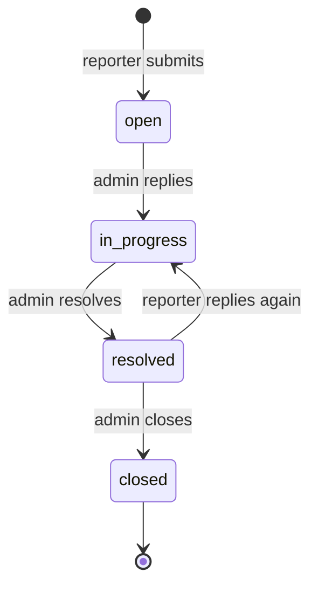

# Issue Portal and Email (useSend)

A lightweight support desk built into EdgeShell. Any user can report an issue.
The reporter sees only their own tickets; administrators see every ticket. Each
ticket is a threaded conversation (a small CRM-style registry) between the
reporter and the admins, with optional email notifications through useSend.

## Who sees what

| Action | monitor / operator | administrator |
|---|---|---|
| Report an issue | yes | yes |
| See own issues | yes | yes |
| See everyone's issues | no | yes |
| Reply in a thread | own issues | any issue |
| Change status | no | yes |

Access is enforced server-side: a user requesting someone else's ticket gets a
403, and the list query is scoped to the reporter unless the user is an admin.

## Lifecycle



## Email notifications (useSend)

Notifications are optional and off by default. When enabled, EdgeShell calls the
useSend API (open source, self-hostable) on three events:

| Event | Recipient |
|---|---|
| New issue reported | all admins, plus a confirmation to the reporter |
| Admin replies | the reporter |
| Reporter replies | all admins |
| Status changed | the reporter |

Sending is best-effort. If useSend is unreachable or unconfigured, the ticket
action still succeeds; the email failure is logged, never raised.

### Configure

Admins configure useSend in the app: Issues > Email Settings (admin only). The
API key is stored encrypted. Environment variables act as a fallback when a
value is not set in the panel. The panel fields map to:

```
Enable email notifications   -> EMAIL_ENABLED
useSend base URL             -> USESEND_BASE_URL
From address                 -> USESEND_FROM
API key                      -> USESEND_API_KEY (stored encrypted in the DB)
```

Equivalent `.env` fallback:

```
EMAIL_ENABLED=true
USESEND_BASE_URL=https://app.usesend.com     # or your self-hosted instance
USESEND_API_KEY=us_your_api_key_here
USESEND_FROM=EdgeShell <noreply@yourdomain.com>
```

EdgeShell posts to `{USESEND_BASE_URL}/api/v1/emails` with
`Authorization: Bearer <API_KEY>` and a JSON body of `from`, `to`, `subject`,
`html`, and `text`, matching the useSend send-email API. Recipient addresses
come from user accounts, so make sure admins and reporters have an email set on
their profile.
