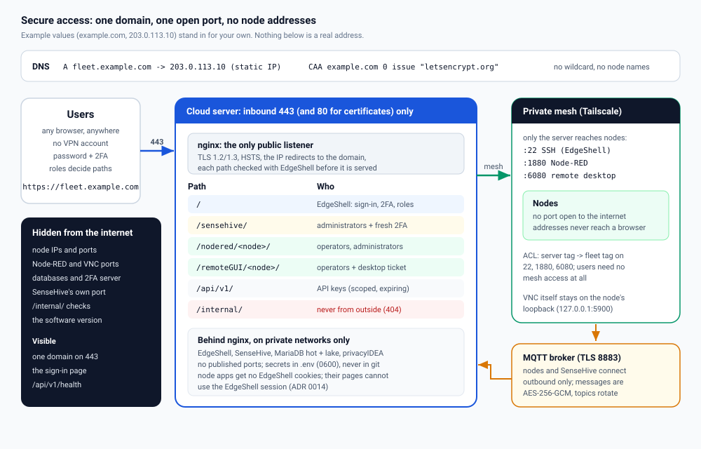

# Secure access: one domain, one open port, no node addresses

How an EdgeShell deployment is exposed to the internet, and how everything else
stays hidden: the DNS records, TLS, which paths exist and who may use them, how
nodes stay unreachable from outside, and how to check it all from outside.

The values below (`example.com`, `fleet.example.com`, `203.0.113.10`) are
documentation examples. Use your own, and keep your real addresses, keys and
`.env` out of any repository.



## Contents

1. [The rule](#the-rule)
2. [DNS](#dns)
3. [Firewall (security group)](#firewall-security-group)
4. [TLS](#tls)
5. [Paths and who may use them](#paths-and-who-may-use-them)
6. [Nodes: reachable only over the mesh](#nodes-reachable-only-over-the-mesh)
7. [Node-RED and the remote desktop through EdgeShell](#node-red-and-the-remote-desktop-through-edgeshell)
8. [Heartbeats: outbound only](#heartbeats-outbound-only)
9. [Secrets](#secrets)
10. [Check it from outside](#check-it-from-outside)
11. [Practices checklist](#practices-checklist)

## The rule

**One domain, port 443, nginx only.** Users need a browser, not a VPN account.
Every other service (EdgeShell itself, SenseHive, the databases, the 2FA
server) listens only on private Docker networks, and the nodes listen only on
the private mesh. Nothing a browser receives contains a node's IP or port.

## DNS

| Record | Value | Why |
| ------ | ----- | --- |
| `A fleet.example.com` | `203.0.113.10` (the server's static IP) | the only name users need |
| `CAA example.com` | `0 issue "letsencrypt.org"` | only Let's Encrypt may issue certificates for the domain (optional, recommended) |

- Use a **static IP** (an Elastic IP on AWS) so the record never goes stale.
- **No wildcard** and **no per-node names**: node names appear only in paths
  behind the sign-in, never in DNS, where anyone can list them.
- Turn on DNSSEC if your DNS provider offers it.
- Email records (SPF, DKIM, DMARC for password-reset mail) are separate: see
  [EMAIL.md](EMAIL.md).

## Firewall (security group)

| Port | From | Purpose |
| ---- | ---- | ------- |
| 443/tcp | anywhere | EdgeShell over HTTPS |
| 80/tcp | anywhere | certificate validation and the redirect to HTTPS |
| 22/tcp | your IP only, or closed (use Tailscale SSH) | server administration |
| 41641/udp | anywhere (optional) | direct Tailscale connections instead of relays |

Nothing else. Do not open 5000, 5051, 3306, 1880 or 6080: those stay inside.

## TLS

- A free Let's Encrypt certificate, issued and renewed by the `certbot`
  container ([DEPLOY-EC2.md](DEPLOY-EC2.md#a6-https-free-certificate-automatic-renewal)).
- TLS 1.2 and 1.3 only, forward-secret ciphers, HSTS for two years.
- Requests to the raw IP or another host name are redirected to the domain, so
  the certificate always matches.

## Paths and who may use them

| Path | Who | How it is checked |
| ---- | --- | ----------------- |
| `/` | signed-in users | password, 2FA, roles, device limits |
| `/sensehive/` | administrators | EdgeShell session plus a SenseHive pass (admin panel or a fresh 2FA code), then SenseHive's own sign-in |
| `/nodered/<node>/` | operators, administrators | EdgeShell checks every request; the node's address stays between EdgeShell and nginx |
| `/remoteGUI/<node>/` | operators, administrators | as above, and the desktop WebSocket needs a 2-minute ticket from the Remote button |
| `/api/v1/` | API keys or signed-in users | scoped, expiring service keys with optional allowed addresses ([API.md](API.md)) |
| `/api/v1/health` | anyone | `{"status": "ok"}` only: no version, no details |
| `/internal/` | nobody | nginx answers 404; only nginx asks EdgeShell these questions |

## Nodes: reachable only over the mesh

- The server joins the private mesh (Tailscale); nodes do too
  ([VPN-NETWORK.md](VPN-NETWORK.md)). EdgeShell and nginx reach nodes on their
  mesh addresses; **users do not need mesh access at all.**
- On each node, allow SSH, Node-RED and the remote desktop **only on the mesh
  interface**:

  ```bash
  sudo ufw default deny incoming
  sudo ufw allow in on tailscale0 to any port 22,1880,6080 proto tcp
  sudo ufw enable
  ```

- Restrict the mesh itself to what is needed. A Tailscale ACL sketch:

  ```json
  {
    "tagOwners": {"tag:edgeshell": ["autogroup:admin"], "tag:fleet": ["autogroup:admin"]},
    "acls": [
      {"action": "accept", "src": ["tag:edgeshell"], "dst": ["tag:fleet:22,1880,6080"]}
    ]
  }
  ```

- OpenRemoteGUI keeps VNC itself on the node's loopback (`127.0.0.1:5900`); only
  its browser gateway (6080) listens on the mesh.

## Node-RED and the remote desktop through EdgeShell

The Node-RED and Remote buttons open `/nodered/<node>/` and
`/remoteGUI/<node>/` on the same domain. nginx asks EdgeShell on every request;
EdgeShell answers with the node's address in a header nginx keeps to itself.
Because these node apps share EdgeShell's address, EdgeShell refuses any
request made by their pages, forbids framing, gives them a different window
opener policy, never forwards its cookies, and needs tickets for the terminal
and the desktop WebSockets. The full model and the remaining risks are in
[ADR 0014](adr/0014-nodered-through-edgeshell.md). Keep Node-RED's own login
(`adminAuth`) on as well.

## Heartbeats: outbound only

The MQTT heartbeat agent on each node and SenseHive on the server connect
**outbound** to a TLS broker (8883). Nothing listens for them. Messages are
AES-256-GCM encrypted per node and topics change every 10 minutes
([HEARTBEAT.md](HEARTBEAT.md)).

## Secrets

- All secrets live in the server's `.env` (mode 0600) or the CI's secret store:
  database passwords, `SECRET_KEY`, `HEARTBEAT_MASTER_KEY`, `SENSEHIVE_API_TOKEN`,
  SMTP credentials, privacyIDEA credentials.
- The repository has only `docker/.env.example` with empty values.
- Images are pinned by digest when deploying, and every download is checked
  against the release's checksums.
- Rotate a secret when it was ever pasted into a chat, a ticket or a log.

## Check it from outside

From any machine (replace the domain):

```bash
D=https://fleet.example.com
curl -s -o /dev/null -w '%{http_code}\n' $D/api/v1/health           # 200
curl -s $D/api/v1/health                                             # {"status":"ok"}: no version
curl -s -o /dev/null -w '%{http_code}\n' $D/internal/admin-check     # 404
curl -s -o /dev/null -w '%{http_code}\n' $D/sensehive/               # 302: sign-in and 2FA first
curl -s -o /dev/null -w '%{redirect_url}\n' $D/nodered/any-node/     # .../login?next=...
curl -sI $D/login | grep -i 'strict-transport\|frame-ancestors\|cross-origin-opener'
nmap -Pn -p 1-65535 fleet.example.com                               # only 80 and 443 open
```

## Practices checklist

| Area | Practice |
| ---- | -------- |
| Confidentiality | TLS everywhere; 2FA for every account; node addresses never shown; secrets only in `.env`; per-node heartbeat keys |
| Integrity | CSRF on every form; same-origin isolation for node apps; signed tickets for terminals and desktops; images by digest; release files by checksum |
| Availability | health checks and automatic restarts; a heartbeat path independent of the VPN; backups before every deploy with automatic rollback |
| Least privilege | three roles; at most 5 administrators and a permanent primary administrator; scoped, expiring API keys; node apps for operators only |
| Accountability | activity log for sign-ins, commands, exports, Node-RED and remote desktop openings |
| Supply chain | CI actions pinned to commits; Dependabot; CodeQL; Bandit; pip-audit; secret scanning; no CDN code in SenseHive |
